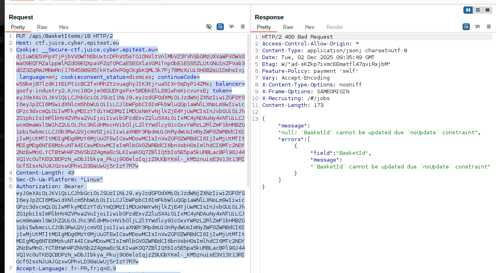

**_Broken Access Control – Level 3 – Manipulate Basket_**

## 1. Methodology

**Step 1 – User Preparation**

- Create or log in using **two distinct accounts** (User A and User B).
- This allows comparison between authorized and unauthorized behaviour.

**Step 2 – Add an Item to Basket (User A)**

- On User A’s session, add any product to the shopping basket.
- Open **Burp Suite -> Proxy -> Intercept ON**.
- Submit the request to add the item.
- The HTTP request is captured and visible in Burp.

**Step 3 – Identify Sensitive Parameters**

Inside the captured request, notice values such as:

```
PUT /api/BasketItems/
{
 "ProductId": 3,
 "BasketId": 2
}
```

or

```
UserId: 15
```

- This reveals that the basket request references a **direct object identifier**, likely the target user/BasketId ID.

**Step 4 – Manipulation**

- Modify the parameter referencing User A’s basket to User B’s ID:

Example:

```
BasketId: 2 -> BasketId: 3
```

- Forward the request.

**Result:**

- The item is added to **User B’s basket** without authentication checks.

**Step 5 – Validation (User B account)**

- Log into User B’s session.
- Verify product presence in User B’s basket.
- The item appears -> access control bypassed -> challenge validated.

---

## Techniques Used

- Parameter tampering
- IDOR exploitation (Insecure Direct Object Reference)
- Broken Access Control

## Tools Used

- Burp Suite (Proxy + Repeater)
- Two browser sessions

---

## 2. Vulnerabilities

**Vulnerability Names:**

- Broken Access Control
- Insecure Direct Object Reference (IDOR)

**Affected Component:**

- Basket management API endpoint (`/api/BasketItems/`)

**Root Cause:**

- Server trusts user-supplied identifiers without enforcing authentication.
- No check performed to validate user ownership of basket data.

**Severity:**

- **High** = direct manipulation of another user’s data.

---

## 3. Risks

- Attackers can modify or delete items from another user’s basket.
- Exposure leads to user account takeover scenarios.
- Escalation path:

  - steal orders,
  - change item prices,
  - cancel purchases,
  - modify delivery addresses.

- **Business Impact:**

- Loss of customer trust due to unauthorized changes in accounts.
- Legal exposure if sensitive data is altered.
- Integrity of transactional system compromised (high financial impact).
- Potential fraud cases through mass automated attacks.

---

## 4. Actions

**Risk Mitigation**

- Implement server-side access control checks:
  - Every basket request must verify `BasketId === authenticatedUserId`.
- Reject externally supplied identifiers and derive them from session tokens.

**Remediation fix**

- Implement access controls

Example

```js
if (basket.ownerId !== req.user.id) {
  return res.status(403).json({ error: "Forbidden" });
}
```

**Best Practices**

- Never trust client-side parameters.
- Replace direct ID references with UUID mappings.
- Enforce role-based access control.
- Apply object-level validation on all modify/read operations.
- Conduct regular pentests focusing on IDOR endpoints.

---

## 5. Evidence

**Manipulated Basket Result**


