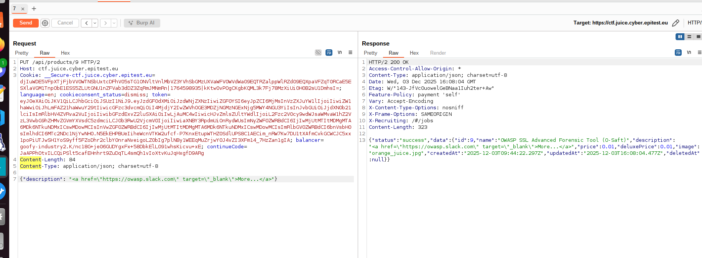

**_Broken Access Control – Level 3 – Product Tampering_**

## 1. Methodology

**Step 1 – Preparation**

- Log in as a regular user with a valid JWT token.
- Navigate to a specific product page (product ID 9).
- Identify that product fields (like description) are editable through a client-side request.

**Step 2 – Interception of the product update request**

- Open **Burp Suite** and enable **Intercept ON**.
- Modify the product description via the Juice Shop interface.
- Capture the outgoing request that updates product information.

**Step 3 – Product tampering & XSS payload injection**

- Modify the product description field in the JSON body.
- Inject an XSS payload such as:

```html
<a href="https://owasp.slack.com" target="_blank"></a>
```

- Forward the request with the altered content.

**Step 4 – Validation of modification**

- Refresh the product page in the browser.
- Observe the modified HTML link being executed/rendered on the page.
- Stored XSS vulnerability confirmed.
- Challenge validated.

---

## Techniques used:

- Stored Cross-Site Scripting (XSS)
- Product data manipulation
- Broken Access Control

## Tools used:

- Burp Suite (Proxy)
- Web Browser

---

## 2. Vulnerabilities

**Vulnerability names:**

- Stored XSS
- Improper Input Validation
- Broken Access Control

**Affected component:**

- Product Update API Endpoint (`PUT /api/Products/{id}`)

**Severity:**

- **High** = arbitrary script execution affecting any user viewing product.

---

## 3. Risks

- Execution of malicious JavaScript for every user visiting the product page.
- Account takeover through stolen cookies/session data.
- Website defacement or malicious redirection.
- Possible session hijacking & CSRF-style chained attacks.
- Business impact: User trust loss, brand damage, legal exposure (GDPR).

---

## 4. Recommended Actions

**Risk Mitigation**

- Move validation and sanitization to server-side logic.
- Reject HTML/script tags within product metadata fields.
- Restrict product modification to privileged accounts only.

**Remediation fixes**

- Implement server-side controls for modifications.”
- Encode HTML output.

Example (Server-side sanitization)

```js
const sanitizeHtml = require("sanitize-html");
product.description = sanitizeHtml(req.body.description);
```

**Best Practices**

- Validate & encode all user inputs (Backend + Frontend).
- Apply Content Security Policy (CSP).
- Perform periodic XSS penetration testing.
- Follow OWASP XSS Prevention Cheat Sheet.

---

## 5. Evidence


