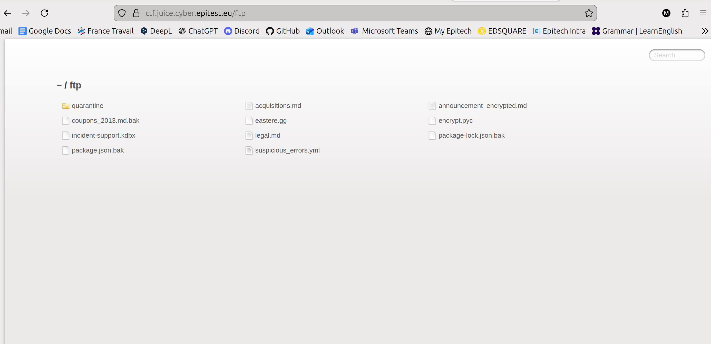
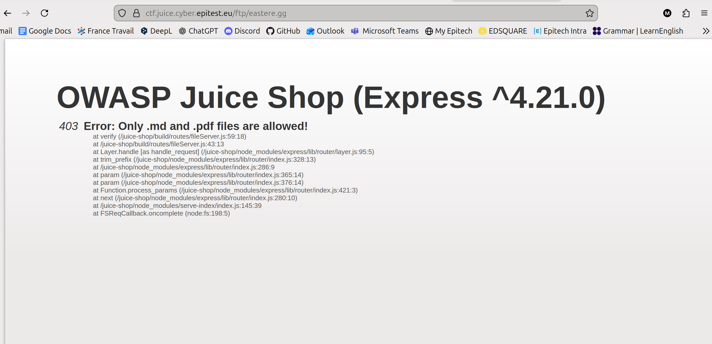
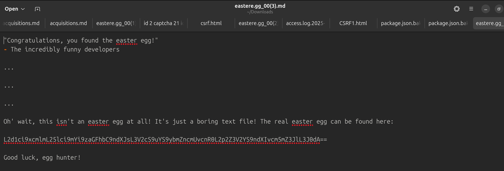

**_Broken Access Control – Level 4 – Easter Egg_**

## 1. Methodology

**Step 1 – Reconnaissance**

- Observation of the general behavior of the **OWASP Juice Shop** application.
- Search for clues and hidden content (Easter Eggs, forgotten files, server errors).

**Step 2 – Exploration via FTP**

- Replace the `/search` segment in the URL with `/ftp`:

`https://ctf.juice.cyber.epitest.eu/ftp`

- This reveals an **FTP directory** accidentally exposed due to a server misconfiguration.

**Step 3 – Discovery of the “eastere.gg” File**

- While browsing the visible files, a file named **`eastere.gg`** stands out.
- Clicking it opens a new page, but direct download fails.

**Step 4 – Exploiting the Poison Null Byte**

- To bypass the server-side file extension check, a **Poison Null Byte** is injected:

`https://juice-shop.example.com/ftp/eastere.gg%2500.md`

- `%2500` represents a **double-encoded NULL byte**.
- The server interprets the file as ending in `.md` and allows the download.

**Step 5 – Retrieval and Validation**

- The file is successfully downloaded as `.md` and contains the Easter Egg.
- Returning to the `/search` page automatically validates three challenges:
  - **Easter Egg**
  - **Poison Null Byte**
  - **Error Handling**

---

## Techniques Used

- Poison Null Byte Injection
- Forced Browsing (Unrestricted File Access)
- Security Misconfiguration Exploitation
- Input Validation Bypass

## Tools Used

- Web Browser
- URL Encoding Tool (to generate `%2500`)

---

## 2. Vulnerabilities

**Vulnerability name:**

- Security Misconfiguration
- Poison Null Byte Injection
- File Disclosure
- Improper Input Validation

**Affected Component:**

- FTP directory file handler

**Severity:**

- **High** = potential exposure of internal files (source code, configuration, credentials)

---

## 3. Risks

- Unauthorized access to internal or sensitive files (logs, source code, `.git` repositories).
- Possible exposure of confidential information.
- Risk of application compromise.
- **Business impact:** data leak, user trust loss, reputational damage.

---

## 4. Actions

**Risk Mitigation**

- Restrict public access to the FTP directory.
- Properly validate filenames on the server side.
- Block control characters such as `%00`, `%2500`, etc.

**Remediation Fix**

- Correct file extension handling: ignore anything after a NULL byte.
- Configure the server to deny access to internal directories.
- Remove `.git` or other sensitive directories from public exposure.

**Best Practices**

- Never expose server directories directly.
- Deploy a **Web Application Firewall (WAF)** to block Null Byte injections.
- Log and monitor abnormal access attempts.
- Perform regular server configuration audits.

---

## 5. Evidence

**Reference on Poison Null Byte Attacks:**  
https://www.cardboard-iguana.com/grimoire/spells/poison-null-byte-attack

**FTP Directory**  

**Inaccessible Easter Egg File**  

**Downloaded Easter Egg File**  

