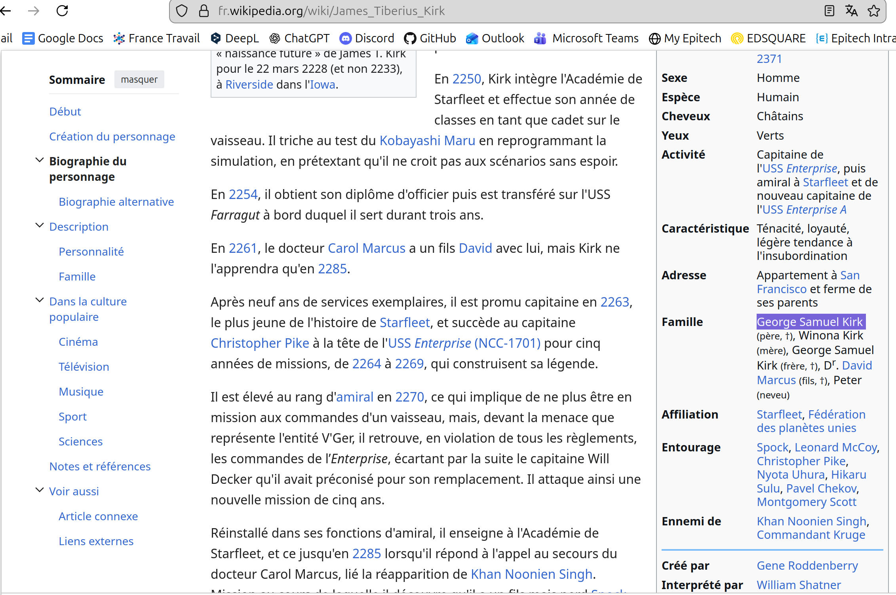

**_Broken Authentication – Level 3 – Reset Jim’s Password_**

## 1. Methodology

**Step 1 – Information Gathering on Jim**

- Go to the **All Products** page.
- Look for products where Jim leaves a comment or appears in a review.
- In the product _"Green Smoothie"_, his email can be found.
- In others, some of Jim’s personal information is revealed.
- Carefully read those reviews: some mention personal details.

**Step 2 – Searching for Information Similar to a “Security Question Answer”**

I’m looking for something like a name, pet name, family member, etc.

**Step 3 – Identify the Security Question Answer**

- Some reviews contain hints about Jim’s personal life.
- By reading comments linked to Jim, we find clues to his secret question.
- In the product _"OWASP Juice Shop-CTF Velcro Patch"_, there’s mention of a **Star fleet symbol**.
- Searching **Star fleet symbol** on the Internet shows it’s related to _Star Trek_.
- I try the question “What’s your favorite movie” -> _Star Trek_, doesn’t work.
- Then I look at _Star Trek_ characters and find **James Tiberius Kirk**.
- Reading further, I see he has a brother named **George Samuel Kirk**.
- The correct answer to the question “What is your oldest sibling's middle name” is:

**Samuel**

**Step 4 – Password Reset Procedure**

- Go to the **Login** page.
- Click **“Forgot your password?”**
- Enter Jim’s email address:

`jim@juice-sh.op`

- The site then displays a secret question.
- Enter the answer found:

`Samuel`

- Define a new password.

**Step 5 – Login**

- Go to the **Login** page.
- Enter Jim’s email and the new password.
- Successful login -> Challenge validated.

---

## Techniques used:

- Type: Passive OSINT and exploitation of a weakness in the password recovery process.
- Objective: The attacker collects public information to guess the answer to a secret question.

## Tools used:

- Web Browser
- Google Search

---

## 2. Vulnerabilities

**Vulnerability name:**

- Weak Security Question
- Broken Authentication
- OSINT-based Password Reset

**Affected component:**

- Password reset process
- Secret question mechanism

**Severity:**

- **High**

---

## 3. Risks

- Compromise of any account whose answer can be guessed through OSINT.
- Lack of additional protection (no confirmation email, no token).
- Possibility of full user account takeover.
- Major risks to data confidentiality.
- Business impact: loss of user trust.

---

## 4. Actions

**Risk Mitigation:**

- Remove secret questions and replace them with modern systems.
- Use an email-based reset link.
- Limit the number of attempts for secret question answers.

**Remediation fixes:**

- Add an MFA (Multi-Factor Authentication) step -> SMS or email code.
- Generate a temporary token required for password reset.
- Forbid answers discoverable via OSINT.

**Example:** Secure reset via token

```js
if (!verifyToken(req.body.token)) {
  return res.status(403).json({ error: "Invalid or expired token" });
}
```

**Best Security Practices:**

- Completely avoid static secret questions.
- Regularly audit authentication processes.
- Educate users not to expose personal information publicly.

---

## 5. Evidence

**Wikipedia page of James Tiberius Kirk**  

