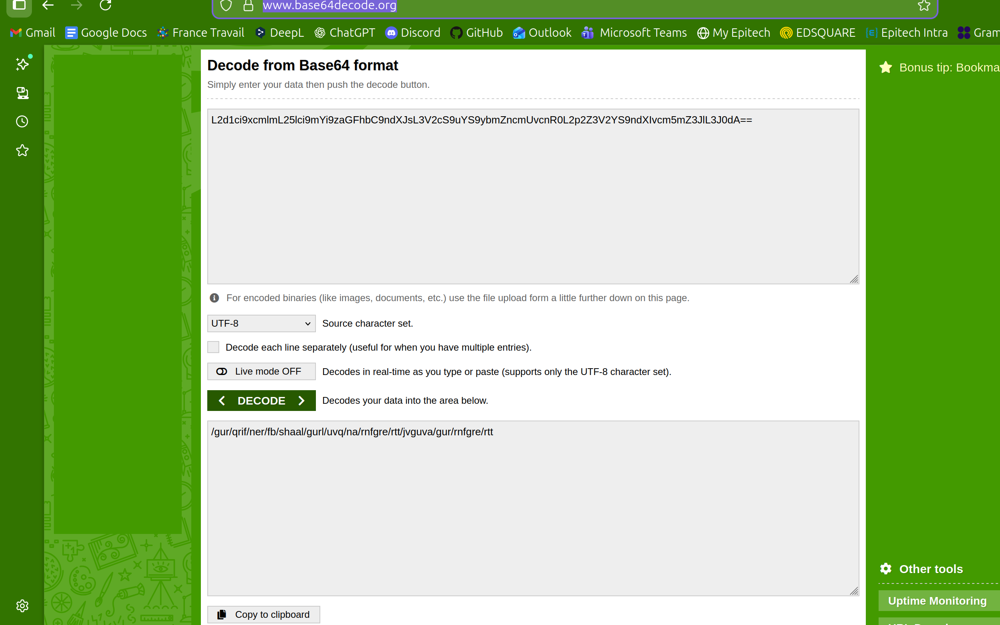
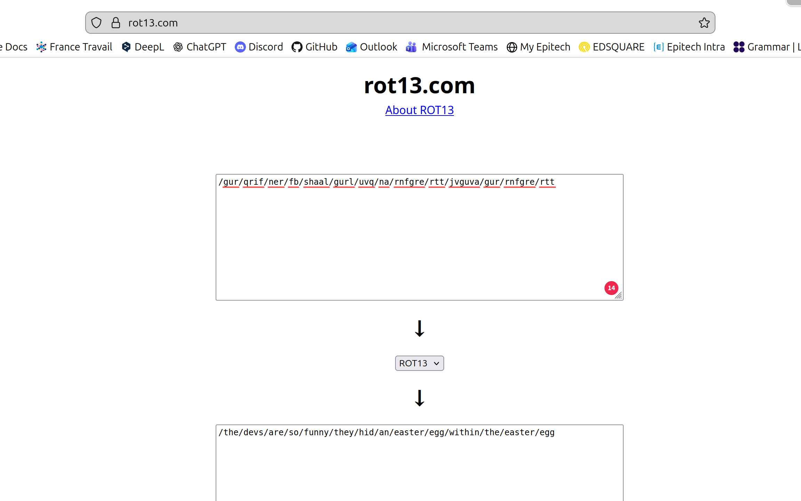

**_Cryptographic Issues – Level 4 – Nested Easter Egg_**

## 1. Methodology

**Step 1 – Access the FTP Page**

- Navigate to:  
  `/ftp`  
  which displays a list of internal site files.
- This direct exposure already indicates a **server misconfiguration**.

**Step 2 – Locate the Easter Egg File**

- Find and click the file named **“eastere egg”** or something similar.
- The file tries to display instead of downloading -> we need to bypass this restriction.

**Step 3 – Exploit the Poison Null Byte**

- To force the download of the file, modify the URL as follows:

  `eastere egg%2500.md`

- `%2500` = double-encoded Null Byte.
- The server believes it’s serving a `.md` file but actually returns the raw file.  
  -> **Exploit successful**.

**Step 4 – Analyze the File Content**

- The downloaded file contains a **Base64-encoded string**:

  `/gur/qrif/ner/fb/shaal/gurl/uvq/na/rnfgre/rtt/jvguva/gur/rnfgre/rtt`

- Go to a Base64 decoding site such as:  
  [https://www.base64decode.org/](https://www.base64decode.org/)

- The result looks **still unreadable**.

**Step 5 – Decrypt Using ROT13**

- Paste the Base64-decoded text into:  
  [https://rot13.com/](https://rot13.com/)
- ROT13 shifts each letter 13 positions in the alphabet.
- The final output reveals a **hidden site path**.

**Step 6 – Access the Nested Easter Egg**

- Append the decoded path to the site URL.
- A new page opens, displaying a **visual Easter Egg**:  
  -> An orange-colored spinning globe.

**Result:**

- A hidden Easter Egg is discovered **inside another Easter Egg** — hence the name _Nested_.
- Challenge validated

---

## Techniques Used

- Security Misconfiguration Exploitation
- Poison Null Byte Injection
- Sensitive File Disclosure
- Weak Cryptography
- Chained Decoding (Base64 + ROT13)

## Tools Used

- Web Browser
- Base64 Decoder
- ROT13 Decoder

---

## 2. Vulnerabilities

**Vulnerability name:**

- Cryptographic Issues
- Security Misconfiguration
- Poison Null Byte Injection
- Sensitive File Exposure
- Insecure File Handling

**Affected Component:**

- FTP navigation page (`/ftp`)
- File download handler

**Severity:**

- **Medium** = Unauthorized access to internal files and server bypass.

---

## 3. Risks

- Leakage of internal information (files, notes, secrets).
- Discovery of hidden or sensitive endpoints.
- Lack of filename filtering demonstrated.
- Potential for more severe attacks (directory traversal, file disclosure, etc.).
- **Business impact:** internal information leak compromising system security and company credibility.

---

## 4. Actions

**Risk Mitigation**

- Restrict public access to the `/ftp` directory.
- Block Null Bytes (`%00`, `%2500`, etc.) in URLs.
- Strictly validate filenames and extensions server-side.

**Remediation Fix**

- Remove all backend directory browsing.
- Only serve explicitly allowed files.
- Clean up internal files and documentation.

**Best Practices**

- Separate public content and internal files into isolated environments.
- Never expose server directories directly.
- Deploy a **Web Application Firewall (WAF)** to block Null Byte injections.
- Always encode and validate file paths received from users.

---

## 5. Evidence

**Base64 Decoder**  

**ROT13 Translator**  

**Nested Easter Egg**  

