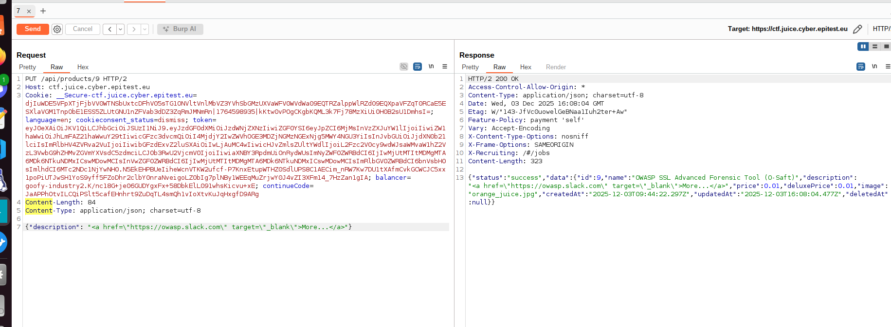

**_Improper Input Validation – Level 3 – Upload Size_**

## 1. Methodology

**Step 1 – Preparation**

- Navigate to a section that allows file uploads (e.g., complaint submission page).
- Open **Burp Suite** and enable **Intercept ON** to capture outgoing upload traffic.

**Step 2 – Initial Upload Attempt**

- Select a file within the size limit using the web interface.
- Submit the form to trigger the upload request.
- Burp captures the HTTP request, revealing file metadata and size values.

**Step 3 – Request Manipulation**

- Locate the file size–related metadata (e.g., `Content-Length`).
- Modify the size value to exceed backend limits (e.g., from KB to several GB).
- Forward or replay the modified request through **Burp Repeater**.

**Step 4 – Validation**

- The backend accepts the manipulated oversized upload request.
- HTTP response indicates success (`204 No Content`), proving the bypass.
- Challenge successfully validated.

---

## 2. Vulnerabilities

**Vulnerability Name:**

- Improper Input Validation (file size)
- Client-side validation trust

**Affected Component:**

- File upload endpoint and storage handler

**Severity:**

- **High**

---

## 3. Risks

- Uploading oversized or malicious files may cause:

  - Disk saturation → system crash
  - Denial of Service through resource exhaustion
  - Bypassing security & business restrictions
  - Potential malware delivery

- **Business Impact:**

  - **Financial Loss:** increased hosting/storage costs.
  - **Operational Failure:** unstable application and downtime.
  - **Reputation Damage:** customer distrust due to platform instability.
  - **Security Weakness:** may enable exploit chaining with uploaded payloads.

---

## 4. Actions

**Risk Mitigation**

- Validate file size **server-side**.
- Reject modified `Content-Length` headers.
- Apply upload limits within server configuration.

**Remediation Fix Example**

Upload endpoint

Example

```js
if (file.size > MAX_SIZE) {
  return res.status(413).json({ error: "File too large" });
}
```

**Best Practices**

- OWASP File Upload Security Guidelines
- Antivirus scanning
- Strict file type & size validation
- Alerting & logging for abusive upload attempts

---

## 5. Evidence Placeholder


