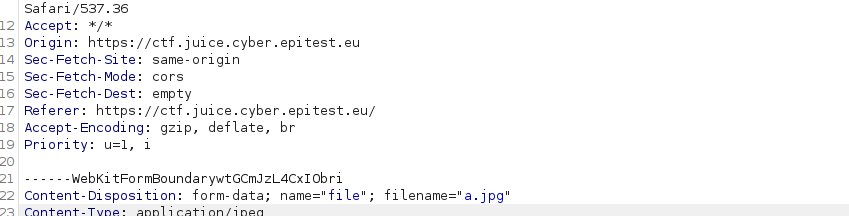

**_Improper Input Validation – Level 3 – Upload Type_**

## 1. Methodology

**Step 1 – Preparation**

- Open **Burp Suite** and enable **Intercept ON**.
- Navigate to the file upload feature on Juice Shop.

**Step 2 – Initial Upload Attempt**

- Try uploading a non-PDF file (e.g., `.png` or `.txt`).
- The application rejects the upload due to frontend validation.

**Step 3 – Capture and Modify the Upload Request**

- Intercept the upload request in Burp Suite.
- Locate the `Content-Type` header (e.g., `image/png`).
- Modify this value to: `application/pdf`.

Example:

```
Content-Type: application/pdf
```

**Step 4 – Forward the Modified Request**

- Forward the modified request through Burp.
- Alternatively, send the request to Repeater and trigger it manually.

**Step 5 – Validation**

- The server stores and accepts the uploaded non-PDF file.
- HTTP response: `204 No Content` → challenge successfully validated.

---

## 2. Vulnerabilities

**Vulnerability Name:**

- Improper Input Validation
- Client-Side Validation Trust

**Affected Component:**

- File upload endpoint `/file-upload`

**Severity:**

- **High** = allows malicious files to enter the system.

---

## 3. Risks

- Uploading disguised files (e.g., webshells).
- Malware distribution.
- Potential remote code execution if the backend processes uploaded files.
- **Business impact:**
  - Loss of system integrity
  - Legal implications if malware spreads
  - Damage to brand image

---

## 4. Actions

**Risk Mitigation**

- Validate MIME type server-side.
- Reject uploads with mismatched magic bytes.

**Remediation Fix**

- Verify the file’s magic bytes and do not rely on client-side headers.

Example validation:

```js
if (!file.mimetype.includes("pdf")) {
  return res.status(400).json({ error: "Invalid file type" });
}
```

**Best Practices**

- OWASP File Upload Security
- Never trust client-side validation
- Implement antivirus scanning on uploaded files

---

## 5. Evidence Placeholder


