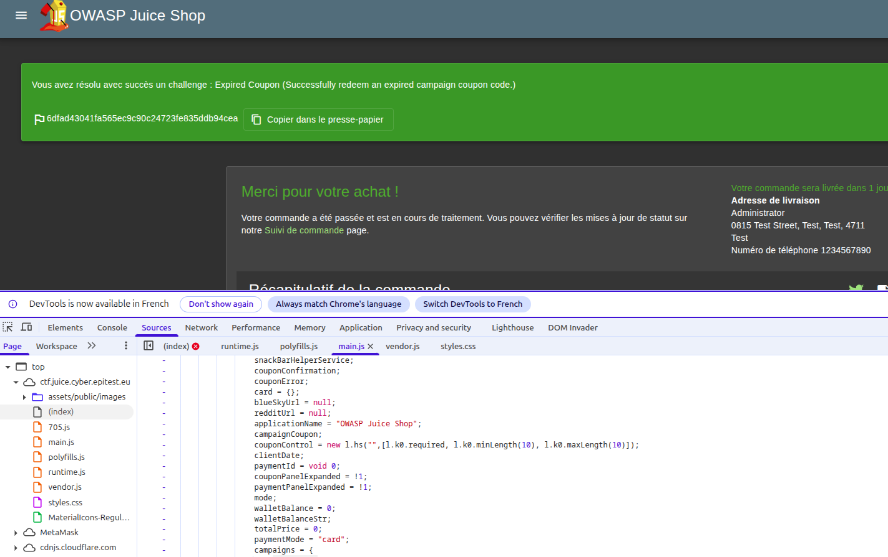

**_Improper Input Validation – Level 4 – Expired Coupon_**

## 1. Methodology

**Step 1 – Preparation**

- Reviewed frontend JavaScript code (`main.js`).
- Identified outdated discount coupons defined client-side within script logic.
- Confirmed coupon validity is checked locally rather than on the backend.

**Step 2 – Client Machine Date Manipulation**

- Modified the system date/time on the attacker workstation to a date before the coupon expiration timestamp.
- This bypassed the client-side expiration validation logic.

**Step 3 – Purchase Submission**

- Submitted a purchase request using a known expired coupon.
- The request was captured and validated through Burp Suite.

**Step 4 – Validation**

- The expired coupon was accepted and applied successfully.
- Challenge validated.

---

## 2. Techniques Used

- Client-side validation bypass
- Parameter tampering
- System date manipulation

---

## 3. Tools Used

- Burp Suite (Proxy interception and replay)
- Browser developer tools
- Local OS time configuration

---

## 4. Vulnerabilities

**Vulnerability Name**

- Improper Input Validation
- Weak Date Validation

**Affected Component**

- Coupon validation system

**Severity**

- **High** = enables financial fraud through expired coupon use

---

## 5. Risks & Business Impact

**Security Risks**

- Unlimited usage of expired promotional codes.
- Large-scale coupon abuse leading to financial losses.
- Increased risk of fraud automation.

- **Business Impact:**

  - Direct financial loss from unauthorized discounts.
  - Damage to business reputation and customer trust.
  - Potential legal exposure in regulated markets.
  - Integrity issues in sales reporting and accounting.

---

## 6. Actions

**Risk Mitigation**

- Validate coupon expiration timestamps **server-side**, not client-side.
- Ignore client machine time completely.

**Remediation Fix**

- Implement strict server-side validation logic.
- Ensure both the coupon activation date and expiration date are checked on each request.
- Reject requests using outdated coupon codes regardless of client date configuration.

```js
if (coupon.expiry < serverTimeNow) {
  return res.status(400).json({ error: "Coupon expired" });
}
```

---

**Best Practices**

- Follow OWASP Input Validation recommendations.
- Remove business logic exposure from frontend code.
- Log coupon usage attempts and detect anomalies proactively.

---

## 7. Evidence


