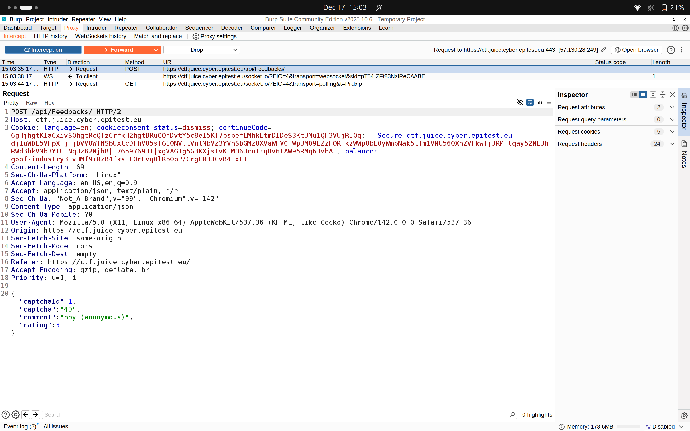
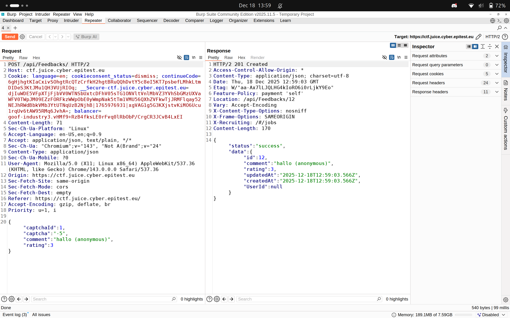

**_Broken Anti Automation – Level 3 – CAPTCHA Bypass_**

## 1. Methodology

**Step 1 – Préparation**

- Déconnexion du compte utilisateur pour tester la fonctionnalité publique “Customer Feedback”.
- Navigation vers la page :

https://juice-shop.example.com/#/contact

**Step 2 – Premier test**

- Saisie du commentaire : `Hey`
- Attribution d’une note de **3 étoiles**
- Résolution du **captcha** manuellement

**Step 3 – Capture de la requête HTTP**

- Ouverture de **Burp Suite**
- Activation du mode **Proxy → Intercept is ON**
- Retour sur la page feedback, puis clic sur “Submit”  
  → La requête POST est interceptée dans Burp Suite.

**Step 4 – Observation et sauvegarde**

- Ouverture du **bloc-notes** pour noter les valeurs importantes :
- `id` du commentaire
- `captcha` soumis
- Répétition du processus **2 fois supplémentaires** pour observer les variations dans la requête et les valeurs dynamiques. Et marquage de `l'id` et `captcha`.
- Cliquer sur forward puis sur **Intercept ON** afin de le passer à OFF.

**Step 5 – Exploitation**

- Revenir sur la page de contact puis rafraichir la page.
- Saisie d’un nouveau message : `Hallloooooo`
- Attribution de 3 étoiles, réponse au captcha
- Activation du **Intercept ON** puis soumission du formulaire à nouveau.
- Clic droit → **Send to Repeater** dans Burp Suite.

**Step 6 – Exploitation via Repeater**

- Envoi de la requête une première fois → obtention d’une **Response Header** valide.
- Répétition multiple de la requête (“spam”) via le bouton **Send** dans Repeater.
- Observation : le serveur accepte les requêtes identiques sans blocage ni vérification supplémentaire.

**Step 7 – Validation**

- Retour sur la page web → “All Products”.
- Challenge validé.

## Techniques utilisées :

- Type: manual testing + intercept/replay attack (anti-automation test)
- Objectif: vérifier si le captcha est validé côté client ou serveur

## Outils utilisés :

- Burp Suite (Proxy + Repeater)
- Bloc-notes

---

## 2. Vulnerabilities

**Vulnerability name:**

- Broken Anti Automation
- Weak CAPTCHA Enforcement

**Affected component:**

- Endpoint de soumission de feedback
- Mécanisme de validation du CAPTCHA côté client (non vérifié côté serveur)

**Severity:**

- **High** = permet un envoi massif de requêtes malgré un captcha censé limiter le spam

---

## 3. Risks

- Possibilité d’abuser du système de feedback (spam).
- Captcha inefficace → automatisation possible via scripts ou Burp Intruder.
- Peut mener à une **pollution de la base de données** (feedbacks multiples inutiles).
- Impact : dégradation du service, atteinte à la crédibilité de la plateforme.

---

## 4. Actions

**Risk Mitigation**

- Mettre en place une **vérification serveur du captcha**, pas seulement côté client.
- Implémenter une **limitation du nombre de requêtes par IP ou utilisateur** (rate limiting).
- Introduire des **tokens CSRF** ou des **challenges dynamiques**.

**Remediation Fix**

- Valider chaque requête de feedback via un **captcha unique et consommable une seule fois**.
- Rejeter les requêtes répétées ou suspectes en analysant les entêtes.
- Enregistrer un log d’activité suspecte et notifier les administrateurs.

**Exemple:** Vérification du captcha côté serveur

```js
if (!verifyCaptcha(req.body.captcha)) {
  return res.status(400).json({ error: "Invalid CAPTCHA" });
}
```

**Best Practices**

- Ne jamais se fier à la seule vérification côté client (JavaScript).
- Déployer des protections automatiques type **reCAPTCHA v3** ou **hCaptcha**.
- Configurer des règles WAF (Web Application Firewall) pour détecter le flood (inondation) de requêtes répétées.

---

## 5. Evidence

- Exemple d’URL utilisée :

POST /api/Feedbacks/
Content-Type: application/json
{
"comment": "Hallloooooo",
"rating": 3,
"captcha": "ab12cd"
}

**Site sur Captcha**
https://medium.com/@mtsboysquad001/captcha-bypass-28de7279865b

**RequêtePOST d'envoie d'un premier commentaire**


**RequêtePOST du dernier commentaire dans Repeater**

