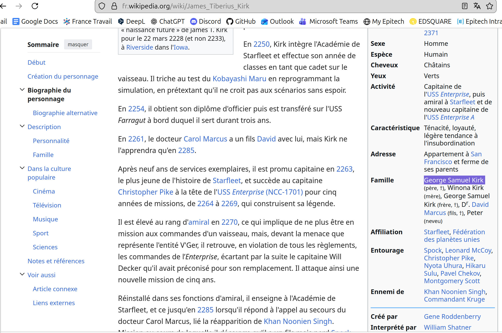

**_Broken Authentication – Level 3 – Reset Jim’s Password_**

## 1. Methodology

**Step 1 – Collecte d’informations sur Jim**

- Aller sur la page **All Products**.
- Rechercher les produits où Jim laisse un commentaire ou apparaît dans une review.
- Dans le produit "Green Smoothie" on trouve son mail.
- Dans d'autres on trouve des informations personnelles de Jim.
- Lire attentivement ces avis : certains mentionnent des détails personnels.

**Step 2 – Je recherche une information qui ressemble à une « réponse de question secrète »**

Donc je cherche un prénom, un nom d’animal, un proche, etc.

**Step 3 – Identifier la réponse à la question secrète**

- Certaines reviews donnent des indices sur la vie personnelle de Jim.
- En lisant les commentaires liés à Jim, on trouve la réponse à sa question secrète.
- Dans le produit "OWASP Juice Shop-CTF Velcro Patch" il est question de **Star fleet symbol**
- Je recherche **Star fleet symbol** sur internet et je voit que ca a un rapport avec Star Trek.
- J'essaie la question "What's your favorite movie" --> Star Trek, ca fonctionne pas.
- Je regarde donc les peronnage de Star Trek et je tombe sur **James Tiberius Kirk**.
- Je lis qu'il a un frere qui s'appelle **George Samuel Kirk**.
- La réponse correcte de la question "what is your oldest sibling's middle name" est :

Samuel

**Step 4 – Procédure de réinitialisation du mot de passe**

- Aller sur la page Login.
- Cliquer sur **“Forgot your password?”**.
- Entrer l’adresse email de Jim :

jim@juice-sh.op

- Le site pose alors une question secrète.
- Entrer la réponse trouvée :

Samuel

- Définir un nouveau mot de passe.

**Step 5 – Connexion**

- Aller sur la page Login.
- Entrer l’email de Jim et le nouveau mot de passe.
- Connexion réussie → challenge validé.

## Outils utilisés :

- Navigateur Web

- Recherche google

---

## 2. Vulnerabilities

**Vulnerability name:**

- Weak Security Question
- Broken Authentication
- OSINT-based Password Reset

**Affected component:**

- Password reset process
- Secret question mechanism

**Severity:**
**High**

---

## 3. Risks

- Compromission de n’importe quel compte dont la réponse peut être devinée via OSINT.
- Absence de protection supplémentaire (pas d’email de confirmation, pas de token).
- Possibilité de prise de contrôle de comptes utilisateurs.
- Risques importants pour la confidentialité des données.

---

## 4. Actions

**Risk Mitigation:**

- Supprimer les questions secrètes au profit de systèmes modernes.
- Utiliser un lien de réinitialisation envoyé par email.
- Limiter le nombre d’essais sur la réponse secrète.

**Remediation fixes:**

- Ajouter une étape MFA (Authentification multifacteur) -> code SMS ou email.
- Générer un token temporaire obligatoire pour le reset.
- Interdire les réponses trouvables via OSINT.

**Best security practices:**

- Éviter complètement les questions secrètes statiques.
- Auditer régulièrement les processus d’authentification.
- Informer les utilisateurs de ne pas exposer publiquement des informations personnelles.

---

## 5. Evidence:

**Page wikipedia de James Thiberius Kirk**

