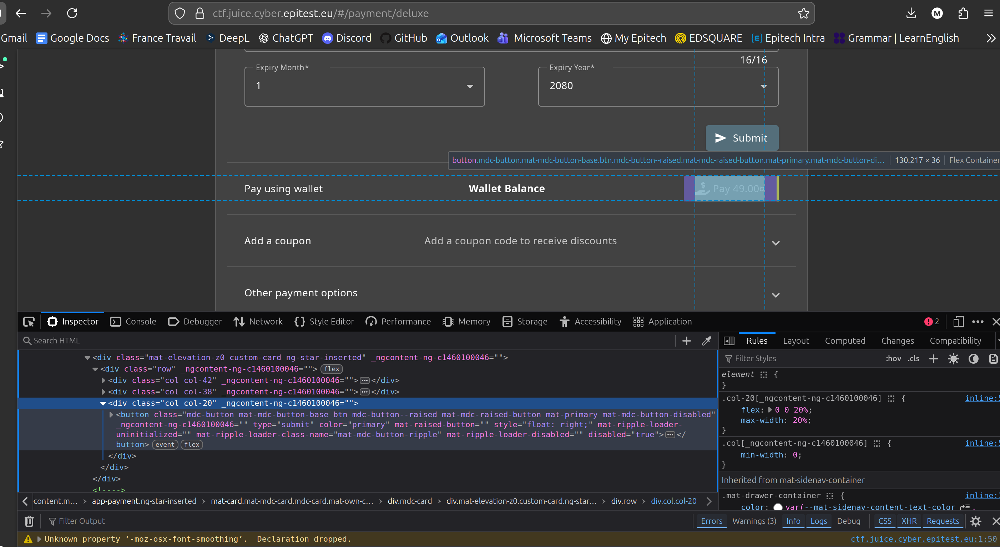
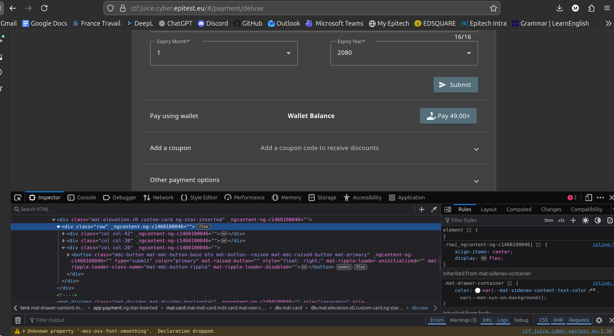
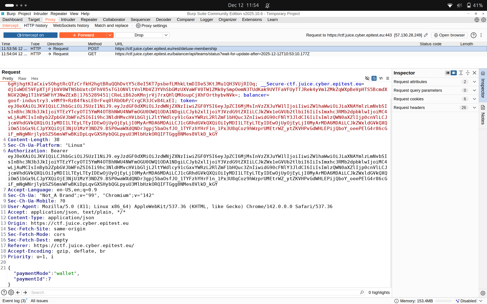
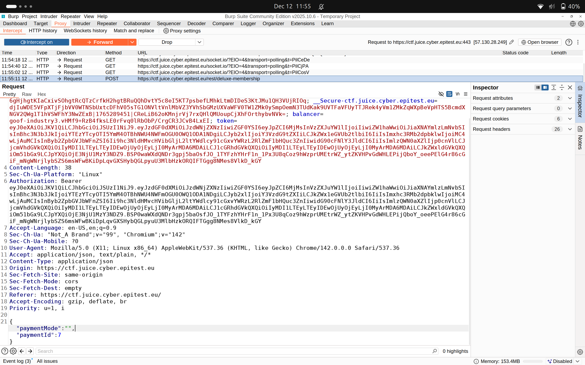

**_Improper Input Validation – Level 3 – Deluxe Fraud_**

## 1. Methodology

**Step 1 – Reconnaissance**

- Navigation sur le site OWASP Juice Shop.
- Accès à l'onglet **Deluxe Membership**.
- Observation qu'un paiement est requis pour devenir membre Deluxe.

**Step 2 – Ajout d'une carte de paiement**

- Cliquer sur **Become a customer**.
- Cliquer sur **Add new card**.
- Entrer des informations de carte fictives.
- Cliquer sur **Submit**.
- Sélectionner la carte ajoutée.

**Step 3 – Analyse du bouton de paiement**

- Le bouton **pay49** est désactivé (grisé).
- Ouverture des DevTools.
- Inspection de l'élément HTML du bouton.

**Step 4 – Contournement côté client**

- Suppression de l'attribut :

      disabled="true"

- Suppression de la classe :

      mat-button-disabled

- Le bouton devient actif (bleu).

**Step 5 – Interception avec Burp Suite**

- Lancement de Burp Suite.
- Activation du proxy (Intercept ON).
- Clic sur le bouton **pay49**.
- Interception de la requête.

**Step 6 – Manipulation de la requête**

- Dans l'onglet Pretty, repérage du champ :

      "paymentMethod": "wallet"

- Suppression de la valeur **wallet**.

- Cliquer sur **Forward**.

- Cliquer sur **Intercept is ON** et revenir sur le site.

**Step 7 – Validation**

- Le paiement est accepté.
- Le challenge est validé.

## Techniques utilisées :

- Client-side control bypass
- Parameter tampering
- Business logic abuse

## Outils utilisés :

- Devtools
- Burp Suite (Proxy)

---

## 2. Vulnerabilities

**Vulnerability:**

- Improper Input Validation
- Broken Access Control

**Affected component:**

- Système de paiement Deluxe

**Severity:**

- **High**

---

## 3. Risks

- Fraude financière.
- Accès non autorisé à un service payant.
- Perte économique et atteinte à la réputation.
- Impact business: Perte financière

---

## 4. Actions

**Risk Mitigation**

- Validation serveur obligatoire.
- Ne jamais faire confiance aux contrôles UI.

**Remediation Fix**

- Vérification stricte de la méthode de paiement côté backend.
- Rejet des paramètres incohérents.

**Example:** vérifier le paiement côté serveur avant d’activer le statut Deluxe

```js
if (!paymentConfirmed(userId)) {
  return res.status(403).json({ error: "Payment required" });
}
```

**Best Practices**

- Logique métier (l’ensemble des règles et comportements propres à ton activité que l’application doit respecter) uniquement côté serveur.
- Journalisation et monitoring.
- Tests réguliers de fraude.

---

## 5. Evidence

**Page web boutton "pay" grise**


**Page web boutton "pay" degrise**


**Requetes initiale envoyee sur Burp**


**Requetes modifiee envoyee sur Burp**

