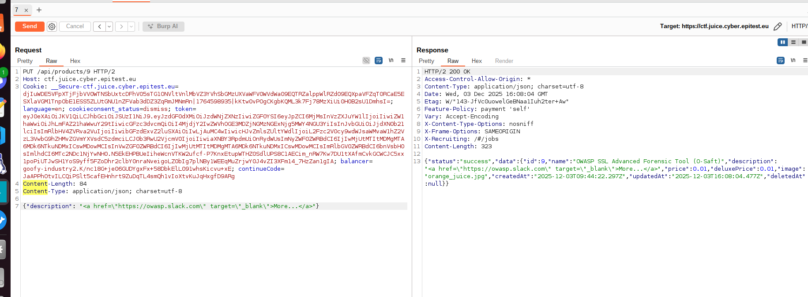

**Improper Input Validation-3-upload size**

## 1. Méthodologie

**Étape 1 – Préparation**

- Aller sur la page pour envoyer des fichiers.(complaint par exemple)

**Étape 2 – Interception**

- Choisir un fichier et capturer la requête avec Burp.

**Étape 3 – Modification**

- Changer la taille du fichier dans la requête pour dépasser la limite.

**Étape 4 – Validation**

- L'envoi réussit même si la limite est dépassée.
- Défi réussi.

## Techniques utilisées :

- Manipulation de paramètres
- Contournement des restrictions d'upload

## Outils utilisés :

- Burp Suite

---

## 2. Vulnérabilités

**Vulnérabilité :**

- Validation d'entrée incorrecte
- Contournement des restrictions d'upload de fichiers

**Composant affecté :**

- Point d'accès d'upload

**Sévérité :**

- **Élevée**

---

## 3. Risques

- Possibilité d'envoyer des fichiers dangereux.

---

## 4. Actions

**Réduction des risques**

- Vérifier la taille côté serveur.

**Correction**

- Mettre en place des contrôles stricts.

**Bonnes pratiques**

- OWASP Upload de fichiers.

---

## 5. Evidence

