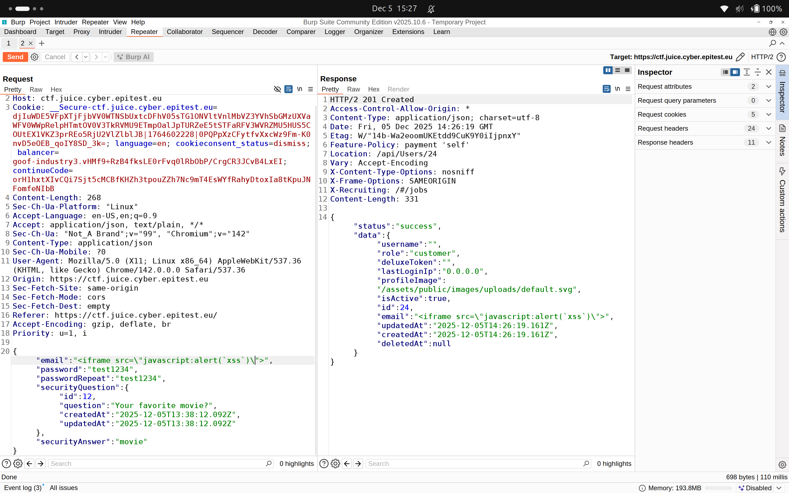

**_XSS – Level 3 – Client-side XSS Protection Bypass_**

## 1. Methodology

**Step 1 – Aller sur la page d’inscription**

- Aller sur la page Login.
- Cliquer sur “Not yet a customer”.
- Créer un compte.

**Step 2 – Préparer Burp Suite**

- Ouvrir Burp Suite → Proxy.
- Passer Intercept sur ON.
- Revenir sur le site et cliquer sur Register pour envoyer la requête.

**Step 3 – Envoyer la requête à Repeater**

- Aller dans Burp → Proxy.
- Trouver la requête POST d’inscription.
- Clic droit → “Send to Repeater”.

**Step 4 – Modifier le champ email pour injecter du XSS**

- Dans Repeater, repérer le champ "email".
- Le remplacer par le payload :
  **<iframe src=\"javascript:alert(`xss`)\">**
- Important : les \ doivent être échappés sinon erreur JSON.

**Step 5 – Lancer la requête**

- Cliquer sur “Send”.
- Consulter la réponse.

**Step 6 – Validation**

- La réponse du serveur contient :  
  "status": "success"  
  → Le XSS est accepté, la protection côté client est contournée.
- Challenge validé.

## Techniques utilisées :

- Client-side XSS Protection Bypass
- Stored XSS injection
- Parameter tampering

## Outils utilisés :

- Burp Suite (Proxy + Repeater)

---

## 2. Vulnerabilities

**Vulnerability name:**

- XSS persistant (Stored XSS)

**Composant affecté :**

- Endpoint de l'API d’enregistrement utilisateur
- Champ JSON "email"

**Severity:**

- **High**

---

## 3. Risks

- Exécution de JavaScript malveillant dans le navigateur des utilisateurs.
- Vol de cookies et de tokens JWT.
- Injection persistante dans la base utilisateur.
- Fuite d’informations et compromission du site.
- Impact business: atteinte à la confiance des utilisateurs + Risque légal et conformité (RGPD)

---

## 4. Actions

**Mitigation**

- Ne jamais se fier à la validation côté client.
- Filtrer toutes les entrées côté serveur.
- Supprimer ou échapper les balises HTML dangereuses.

**Remediation**

- Encoder automatiquement `<`, `>`, `"`, `'`.
- Utiliser un moteur de sanitisation robuste.
- Vérifier que le champ email contient un email valide.

**Exemple:** validation stricte du champ email

```js
import validator from "validator";

if (!validator.isEmail(email)) {
  return res.status(400).json({ error: "Invalid email format" });
}
```

**Best Practices**

- Mettre en place une Content Security Policy (CSP).
- Auditer régulièrement les formulaires du site.
- Tester automatiquement contre les attaques XSS.

---

## 5. Evidence

Payload injecté :

**<iframe src=\"javascript:alert(`xss`)\">**

Réponse du serveur :  
"status": "success"

**Resultat de la Requête avec payload injecté**

