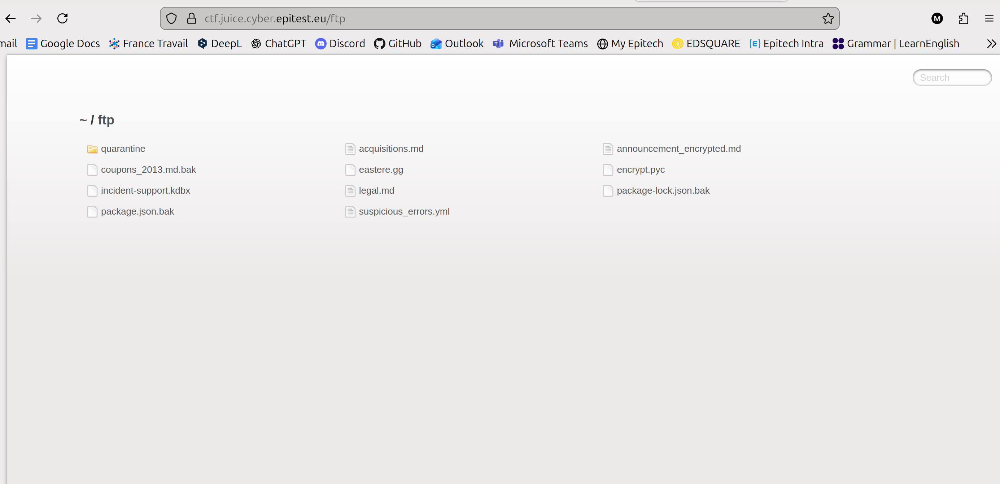
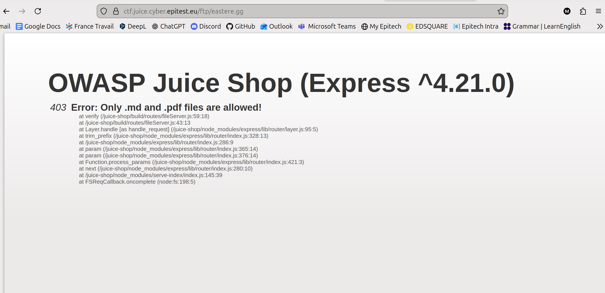
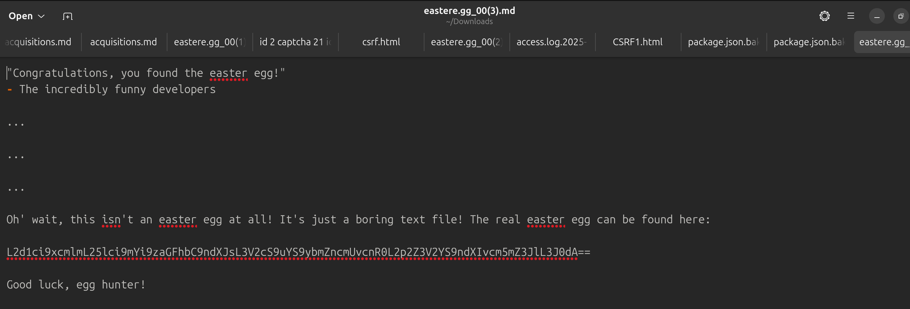

**_Broken Access Control – Level 4 – Easter Egg_**

## 1. Methodology

**Step 1 – Reconnaissance**

- Observation du comportement général de l’application **OWASP Juice Shop**.
- Recherche d’indices et de contenus cachés (Easter Eggs, fichiers oubliés, erreurs serveur).

**Step 2 – Exploration via FTP**

- Remplacement du segment `/search` dans l’URL par `/ftp` :

https://ctf.juice.cyber.epitest.eu/ftp

- Cela révèle un répertoire FTP accessible par erreur (mauvaise configuration serveur).

**Step 3 – Découverte du fichier “eastere.gg”**

- En parcourant les fichiers visibles, un fichier nommé `eastere.gg` attire l’attention.
- Cliquer dessus l’ouvre dans une nouvelle fenêtre, mais le téléchargement direct échoue.

**Step 4 – Exploitation du Poison Null Byte**

- Pour contourner la vérification d’extension côté serveur, injection d’un **Poison Null Byte** :

https://juice-shop.example.com/ftp/eastere.gg%2500.md

`%2500` correspond à un **NULL byte encodé deux fois**.

- Le serveur interprète alors la fin du nom de fichier comme `.md` et autorise le téléchargement.

**Step 5 – Récupération et validation**

- Le fichier est téléchargé avec succès en `.md` et contient l’easter egg.
- En revenant sur la page `/search`, les trois flags sont automatiquement validés :
- **Easter Egg**
- **Poison Null Byte**
- **Error Handling**

## Techniques utilisées :

- Poison Null Byte Injection
- Forced Browsing (Unrestricted File Access)
- Security Misconfiguration Exploitation
- Input Validation Bypass

## Outils utilisés :

- Navigateur web
- URL encoding tool (pour générer `%2500`)

---

## 2. Vulnerabilities

**Vulnerability name:**

- Security Misconfiguration
- Poison Null Byte Injection
- File Disclosure
- Improper Input Validation

**Affected component:**

File handler du répertoire FTP

**Severity:**

- **High** = Fuite potentielle de fichiers internes (source, config, credentials)

---

## 3. Risks

- Accès non autorisé à des fichiers internes ou sensibles (logs, code source, fichiers `.git`).
- Possibilité d’obtenir des données confidentielles.
- Risques de compromission.
- Impact business : **data leak**, **perte de confiance utilisateur**, **atteinte à la réputation**.

---

## 4. Actions

**Risk Mitigation**

- Restreindre l’accès public au répertoire FTP.
- Valider correctement les noms de fichiers côté serveur.
- Bloquer les caractères de contrôle tels que `%00`, `%2500`, etc.

**Remediation Fix**

- Corriger la gestion des extensions : ignorer tout ce qui suit un byte NULL.
- Configurer le serveur pour interdire les répertoires internes.
- Supprimer les traces de répertoires `.git` ou autres fichiers sensibles.

**Best Practices**

- Ne jamais exposer directement des répertoires serveurs.
- Mettre en place un **WAF** (Web Application Firewall) pour bloquer les Null Byte injections.
- Journaliser et surveiller les tentatives d’accès anormales.
- Réaliser des audits réguliers de configuration serveur.

---

## 5. Evidence

**Site sur les Poison Null Byte**
https://www.cardboard-iguana.com/grimoire/spells/poison-null-byte-attack

**Répertoire FTP**

**Fichier easter egg non accessible**

**Fichier easter egg téléchargé**

