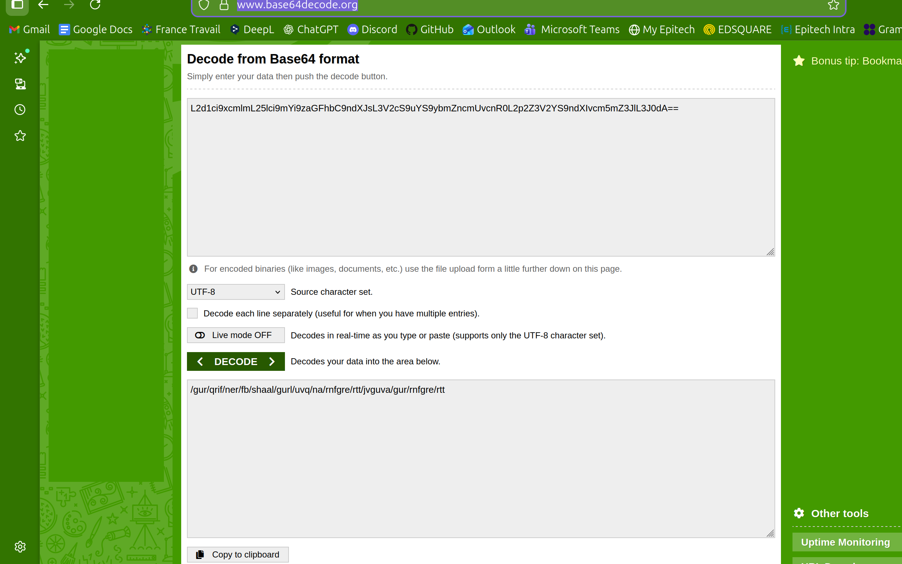
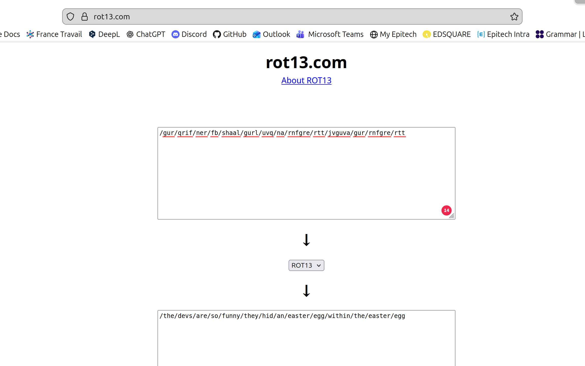

**_Cryptographic Issues – Level 4 – Nested Easter Egg_**

## 1. Methodology

**Step 1 – Accéder à la page FTP**

- Aller sur la page :  
  `/ftp`  
  qui affiche une liste de fichiers internes du site.
- Cette exposition directe est déjà une mauvaise configuration serveur.

**Step 2 – Trouver le fichier Easter Egg**

- Repérer et cliquer sur le fichier nommé **“eastere egg”** ou similaire.
- Le fichier tente de s’afficher au lieu d’être téléchargé → il faut contourner cette restriction.

**Step 3 – Exploiter le Poison Null Byte**

- Pour forcer le téléchargement du fichier, modifier l’URL :

  `eastere egg%2500.md`

- `%2500` = Null Byte double-encodé
- Le serveur pense servir un `.md`, mais renvoie le fichier brut → exploitation réussie.

**Step 4 – Analyse du contenu**

- Le fichier téléchargé contient une chaîne encodée en Base64 :

  `/gur/qrif/ner/fb/shaal/gurl/uvq/na/rnfgre/rtt/jvguva/gur/rnfgre/rtt`

- Aller sur un site de décodage Base64 :  
  https://www.base64decode.org/

- Résultat : une chaîne qui semble encore illisible.

**Step 5 – Déchiffrement ROT13**

- Coller le résultat Base64 dans :  
  https://rot13.com/
- ROT13 convertit chaque lettre 13 positions plus loin dans l’alphabet.
- Le résultat final révèle un **chemin caché** du site.

**Step 6 – Accéder au Nested Easter Egg**

- Ajouter le path décodé à l’URL du site.
- Une nouvelle page s’ouvre, contenant un **Easter Egg graphique** :  
  → Une terre de couleur orange tournant sur elle-même.

**Résultat :**

- On a trouvé un Easter Egg caché dans un autre Easter Egg (d’où le nom _Nested_).
- Challenge validé !

**Outils utilisés :**

- Navigateur web
- Base64 Decode Tool
- ROT13 Tool
- (Optionnel) Burp Suite pour inspecter les requêtes

---

## 2. Vulnerabilities

**Vulnerability name :**

- Security Misconfiguration
- Poison Null Byte Injection
- Sensitive File Exposure
- Insecure File Handling

**Affected component :**

- FTP browsing (`/ftp`)
- File download handler
- Encoded hint storage

**Severity :**

- **Medium / High** = accès non autorisé à des fichiers internes + contournement du serveur.

---

## 3. Risks

- Fuite d’informations internes (files, notes, secrets).
- Possibilité de découvrir d'autres endpoints cachés ou sensibles.
- Démonstration d’une absence de filtrage sur les noms de fichiers.
- Potentiel d’attaques plus graves (directory traversal, disclosure, etc.).

---

## 4. Actions

### Risk Mitigation

- Interdire l’accès public au répertoire `/ftp`.
- Bloquer les Null Bytes (`%00`, `%2500`…) dans les URLs.
- Valider strictement les noms et extensions de fichiers côté serveur.

### Remediation Fix

- Supprimer toute navigation dans les répertoires backend.
- Ne servir que des fichiers explicitement autorisés.
- Nettoyer les données et supprimer les fichiers d’aide internes.

### Best Practices

- Séparer contenu public et fichiers internes dans deux environnements distincts.
- Activer un WAF pour détecter des patterns d’exploitation.
- Toujours encoder et valider les chemins de fichiers envoyés par les utilisateurs.

---

## 5. Evidence

**Decodeur base64**

**Traducteur Rot13**

**Nested Egg**

