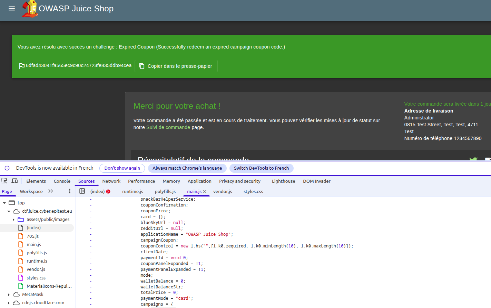

**Improper Input Validation-4-Expired Coupon**

## 1. Methodology

**Step 1 – Préparation**

- Vérification du code de la page.
- On voit dans Main.js des coupon périmée.

**Step 2 – Modification de la date**

- Modification de l'heure du pc.

**Step 3 – Soumission**

- Envoi de la requête d'âchat avec le coupon périmée.

**Step 4 – Validation**

- Coupon utilisé avec succès.
- Challenge validé.

## Techniques utilisées:

- Parameter Tampering
- Date Manipulation

## Outils utilisés :

- Burp Suite

---

## 2. Vulnerabilities

**Vulnerability:**

- Improper Input Validation
- Weak Date Validation

**Affected component:**

- Système de coupon

**Severity:**

- **High**

---

## 3. Risks

- Utilisation de coupons expirés.

---

## 4. Actions

**Risk Mitigation**

- Valider les dates côté serveur.

**Remediation Fix**

- Implémenter des contrôles stricts.

**Best Practices**

- OWASP Input Validation.

---

## 5. Evidence

