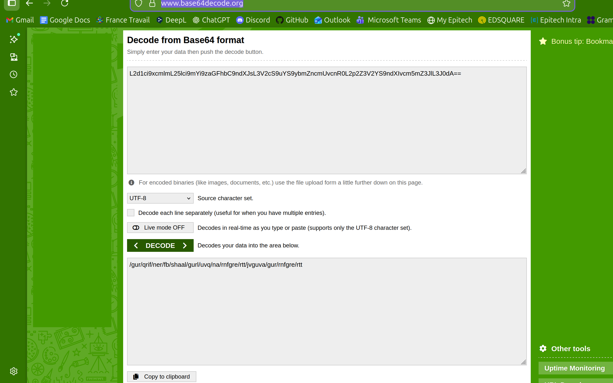
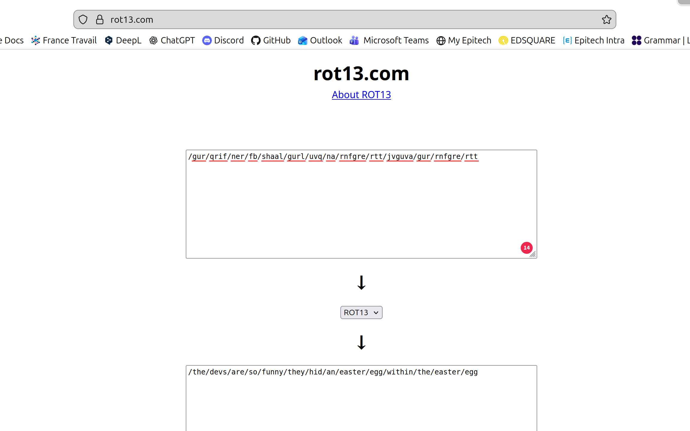

**_Improper Input Validation – Level 4 – Poison Null Byte File Access_**

## 1. Methodology

**Step 1 – Accéder à la page FTP**

- Aller sur la page `/ftp` du Juice Shop.
- Cette page expose une liste de fichiers internes du site.
- Repérer le fichier nommé **“eastere egg”** ou similaire.

**Step 2 – Tenter d’ouvrir le fichier**

- Cliquer sur le fichier.
- Le serveur refuse de le télécharger correctement car il ne reconnaît pas l’extension.

**Step 3 – Exploiter le Poison Null Byte**

- Pour contourner cette protection, modifier l’URL en ajoutant un Null Byte encodé :

%2500.md

- Exemple complet :

/ftp/eastere egg%2500.md

**Pourquoi ca fonctionne ?**

- Le serveur voit : “un fichier `.md` → autorisé”.
- Le système de fichiers voit : “eastere egg” (il s’arrête au Null Byte).
- Résultat : accès accordé au fichier qui ne devrait pas être téléchargeable.

**Step 4 – Télécharger et lire le fichier**

- Le fichier téléchargé contient une chaîne encodée en Base64 :

/gur/qrif/ner/fb/shaal/gurl/uvq/na/rnfgre/rtt/jvguva/gur/rnfgre/rtt

**Step 5 – Décodage Base64**

- Aller sur : https://www.base64decode.org/
- Coller la chaîne → résultat illisible (texte encodé).

**Step 6 – Déchiffrement ROT13**

- Aller sur : https://rot13.com/
- Coller le texte Base64 décodé.
- ROT13 révèle un **chemin secret** utilisable dans l’URL.

**Step 7 – Accéder au Nested Easter Egg**

- Ajouter ce path à l’URL du Juice Shop.
- Une page cachée apparaît, contenant une **terre orange qui tourne**.
- Challenge validé.

---

## 2. Vulnerabilities

**Vulnerability name:**

- Poison Null Byte Injection
- Unrestricted File Access
- Security Misconfiguration
- Sensitive Information Disclosure

**Affected component:**

- File download handler
- FTP directory exposure `/ftp`
- Input validation (filename parsing)

**Severity:** High

---

## 3. Risks

- Accès non autorisé à des fichiers internes.
- Possibilité de contourner les protections d’extension.
- Lecture de données sensibles ou potentiellement critiques.
- Risque d’exposition de chemins, secrets ou de fichiers de configuration.
- Dégradation de la sécurité générale du serveur.

---

## 4. Actions

**Risk mitigation:**

- Filtrer toutes les chaînes incluant `\0`, `%00`, `%2500`.
- Interdire toute navigation dans des répertoires internes.
- Restreindre strictement les formats de fichiers autorisés.

**Remediation fixes:**

- Utiliser des fonctions sûres (non basées sur C) pour gérer les chemins de fichiers.
- Nettoyer les entrées afin de supprimer les Null Bytes.
- Désactiver la page `/ftp` ou la protéger via authentification.

**Best security practices:**

- Ne jamais exposer de répertoires système.
- Valider côté serveur les noms de fichiers et extensions.
- Auditer régulièrement les endpoints accessibles publiquement.

---

## 5. Evidence

**Decodeur base64**

**Traducteur Rot13**

**Nested Egg**

