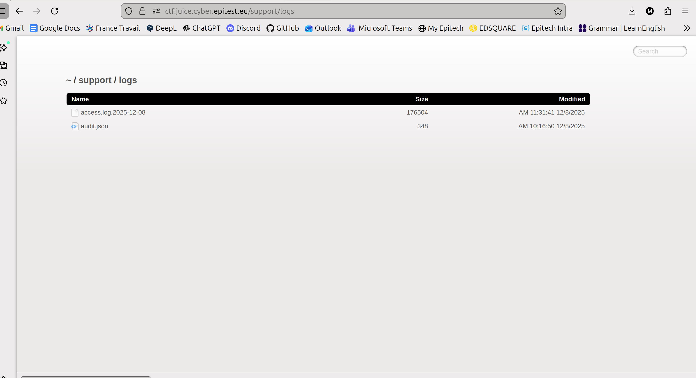
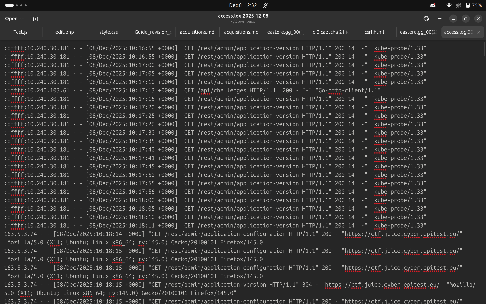

**_Sensitive Data Exposure – Level 4 – Access Log_**

## 1. Methodology

**Step 1 – Reconnaissance**

- Analyse initiale du site pour comprendre son comportement général.
- Observation des pages accessibles sans authentification.
- Inspection des requêtes HTTP via Burp Suite et DevTools.

**Step 2 – Navigation vers /support/logs**

Accès à la page :

    https://target-website.com/support/logs

Aucun contrôle d'accès → suspicion de Broken Access Control.

**Step 3 – Téléchargement du fichier log**

- Téléchargement direct du fichier (ex : `access.log`).
- Aucune authentification requise → exposition d'un fichier sensible.

**Step 4 – Analyse du fichier**

Le fichier contient potentiellement : - adresses IP, - chemins
internes, - messages d'erreur, - données sensibles.

**Step 5 – Validation du challenge**

Le challenge se valide après le téléchargement du fichier.

## Outils utilisés :

- Burp suit

- DevTools

---

## 2. Vulnerabilities

**Vulnerability** : Broken Access Control -- Missing Authorization /
IDOR\
**Affected component** : Route `/support/logs` et système de
journalisation\
**Severity:**
**High / Critical**

---

## 3. Risks

- Fuite d'informations sensibles (logs).
- Facilitation d'attaques avancées.
- Impact business : data leak, perte de confiance, atteinte à la
  réputation.

---

## 4. Actions

**Risk Mitigation**

- Restreindre l'accès à /support/logs.
- Déplacer les logs hors du répertoire public.
- Appliquer RBAC.

**Remediation Fix**

- Ajouter un middleware d'autorisation.
- Bloquer l'accès direct aux fichiers internes.
- Revoir la configuration serveur.

**Best Practices**

- Ne jamais exposer les logs au public.
- Utiliser un WAF.
- Appliquer les recommandations OWASP.
- Auditer régulièrement les permissions.

---

## 5. Evidence

**Page /support/logs**

**Fichier log**

