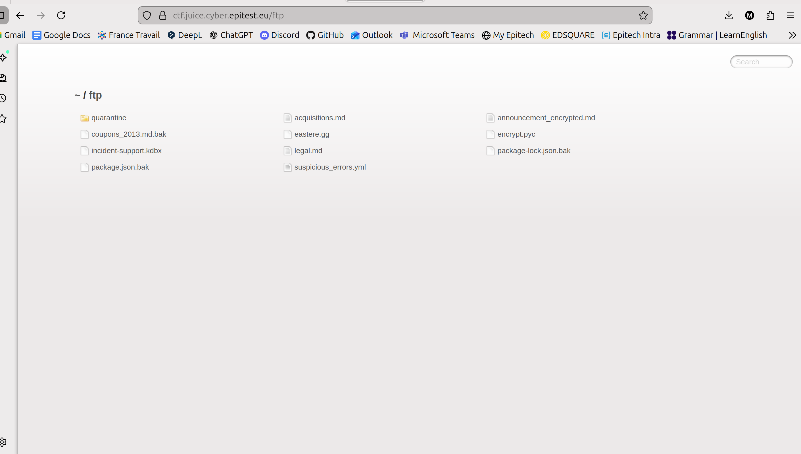
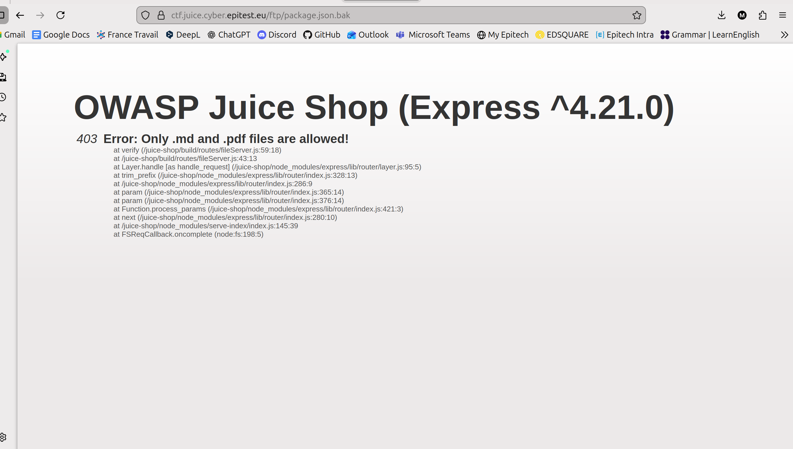
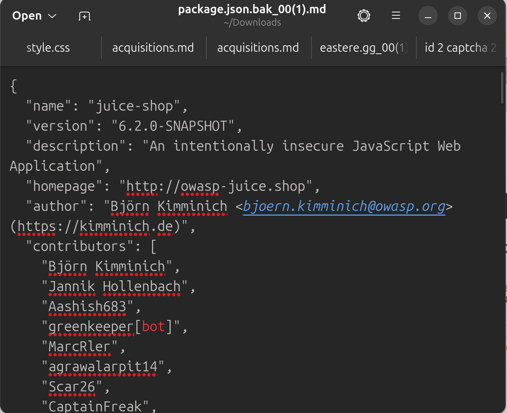

**_Sensitive Data Exposure – Level 4 – Forgotten Developer Backup_**

## 1. Methodology

**Step 1 – Reconnaissance**

- Navigation sur l'application **OWASP Juice Shop**.
- Observation de la structure des URLs.
- Recherche de fichiers de sauvegarde oubliés.

**Step 2 – Accès au répertoire FTP**

- Ajout de `/ftp` dans l'URL :

  https://juice-shop.example.com/ftp

- Le serveur expose une liste de fichiers.

**Step 3 – Découverte du fichier de backup**

- Présence d'un fichier :

  **package.json.bak**

- Tentative d'ouverture directe refusée.
- Message : seuls les fichiers `.md` ou `.pdf` sont autorisés.

**Step 4 – Bypass du filtre d'extension**

- Ajout d'un Null Byte doublement encodé :

  **%2500.md**

- URL utilisée :

  https://juice-shop.example.com/ftp/package.json.bak%2500.md

- Téléchargement du fichier réussi.

**Step 5 – Analyse**

- Lecture du fichier de sauvegarde.
- Identification de dépendances et composants internes.
- Le challenge est validé.

---

## Techniques utilisées :

- Information Disclosure
- Poison Null Byte Injection
- File Extension Filter Bypass
- Security Misconfiguration Exploitation

## Outils utilisés

- Navigateur web
- Encodage d'URL (%2500)
- OSINT basique

---

## 2. Vulnerabilities

**Vulnerability:**

- Sensitive Data Exposure
- Vulnerable & Outdated Components
- Forgotten Backup Exposure

**Affected component:**

- Répertoire FTP et fichiers de backup

**Severity:**

- **High**

---

## 3. Risks

- Fuite d'informations internes.
- Aide à la reconnaissance d'attaques.
- Augmentation de la surface d'attaque.
- Impact business : exposition d’informations internes pouvant faciliter des attaques ciblées + perte de confiance des utilisateurs.

---

## 4. Actions

**Risk Mitigation**

- Supprimer les fichiers de backup.
- Restreindre l'accès FTP.

**Remediation Fix**

- Validation stricte des extensions.
- Normalisation des chemins.
- Stockage hors racine web.

**Exemple:** bloquer les noms de fichiers incluant des Null Bytes (\0)

```js
if (filename.includes("\0") || filename.includes("%00")) {
  return res.status(400).json({ error: "Invalid filename" });
}
```

**Best Practices**

- Ne jamais déployer de backups en production.
- Audits réguliers.
- Suivre les recommandations OWASP.

---

## 5. Evidence

**Site Recommandations OWASP**
https://cheatsheetseries.owasp.org/index.html

**Répertoire FTP**


**Package.json.back**


**Ficher package.json.back téléchargé**

