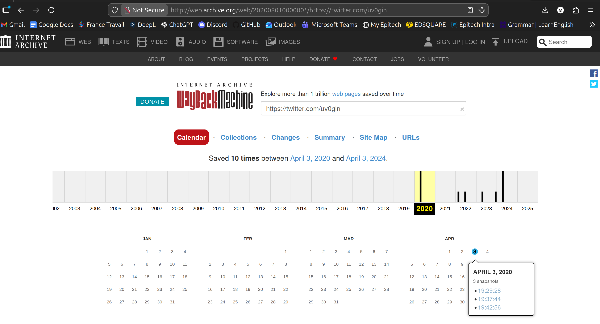
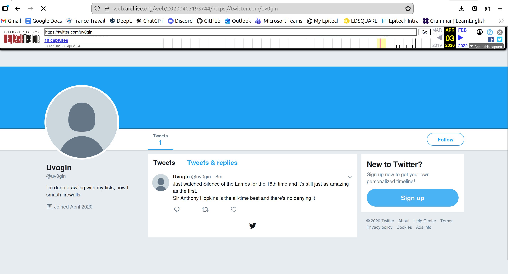

**_Sensitive Data Exposure -- Level 4 -- Reset Uvogin's Password_**

## 1. Methodology

### Step 1 – Reconnaissance

- Navigation sur le site pour repérer les fonctionnalités sensibles.
- Identification de la page **"Forgot my password"**.
- Analyse du formulaire : email + question personnelle.

### Step 2 – Identification de la cible

- L'utilisateur ciblé est **Uvogin**.
- Saisie de son email dans la page de réinitialisation.

### Step 3 – OSINT : Recherche Internet

- Recherche du nom _"Uvogin"_.
- Découverte du profil X (anciennement Twitter) :\
  https://x.com/uv0gin

### Step 4 – Exploration via Wayback Machine

- Recherche des snapshots 2025 → aucun.
- Recherche 2024 → 2 snapshots non exploitables.
- Changement d'URL en version Twitter : https://twitter.com/uv0gin
- Exploration 2024--2022 → aucun résultat utile.
- Un snapshot de **2020**, le **3 avril 19h37**, mentionne le film\
  **"Silence of the Lambs"**.

### Step 5 – Exploitation

- Retour sur la page _Forgot my password_.
- Entrée de la réponse : **Silence of the Lambs**.
- Définition d'un nouveau mot de passe.
- Réinitialisation réussie → accès au compte.

### Outils utilisés

- Navigateur Web
- Wayback Machine
- Outils OSINT / recherche Google
- DevTools

---

## 2. Vulnerabilities

**Vulnerability** : Broken Access Control -- Weak Personal Question /
OSINT-Based Account Takeover\
**Affected component** : Password reset system\
**Severity:**  
**Critical**

---

## 3. Risks

- Prise de contrôle du compte utilisateur.
- Accès non autorisé à des données sensibles.
- Risques business : fuite de données, perte de confiance, atteinte à
  la réputation.

---

## 4. Actions

**Risk Mitigation**

- Supprimer les questions secrètes basées sur des informations
  publiques.
- Utiliser MFA ou un lien de récupération unique et sécurisé.
- Vérifier l'identité via email ou téléphone.

**Remediation Fix**

- Remplacer le système de questions secrètes.
- Chiffrer et protéger les données de récupération.
- Ajouter une détection d'activité suspecte sur les resets.

**Best Practices**

- Ne jamais utiliser de questions secrètes dont les réponses sont
  trouvables via OSINT.
- Appliquer les recommandations OWASP Authentication.
- Auditer régulièrement les mécanismes de récupération de comptes.

---

## 5. Evidence

**Wayback Machine snapshot**

**Uvogin twitter**

