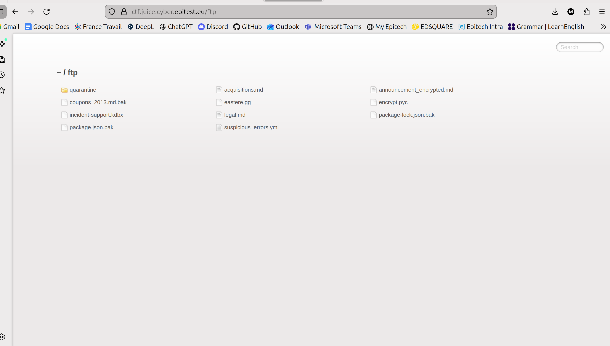
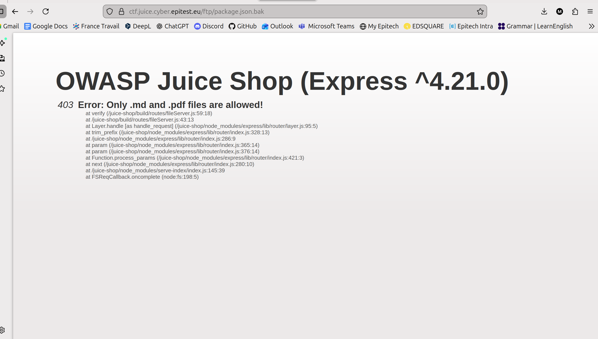
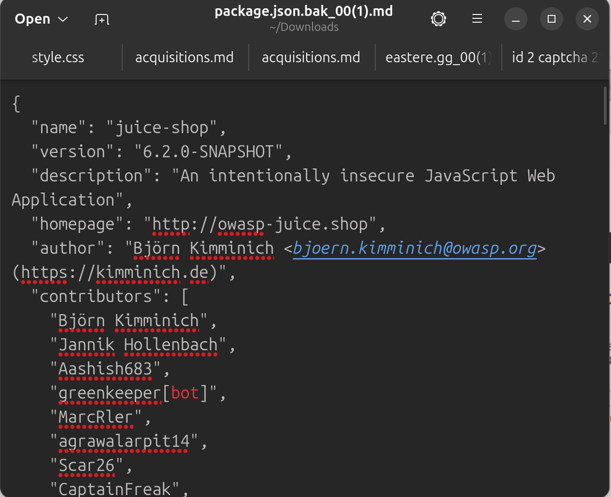
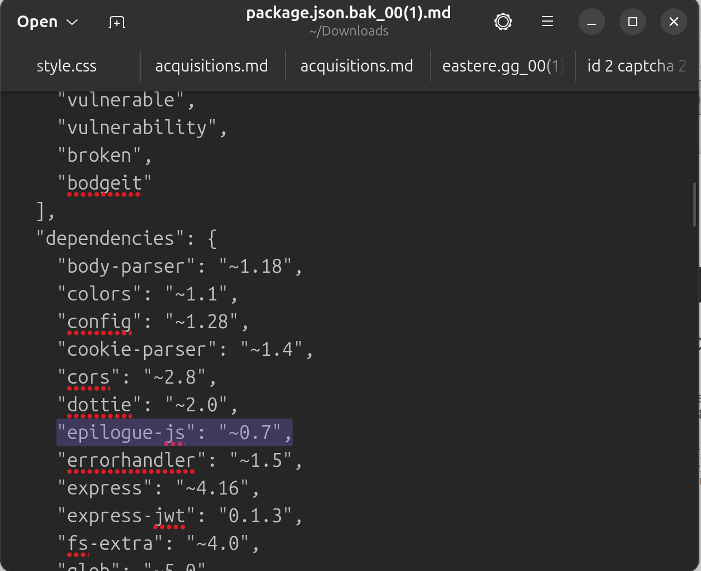
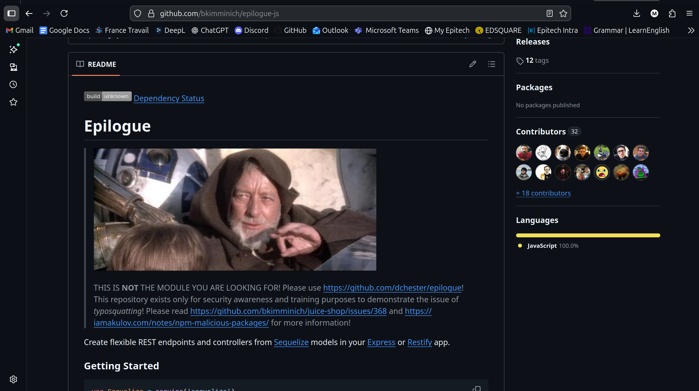

**_Vulnerable Components – Level 4 – Legacy Typosquatting_**

## 1. Methodology

**Step 1 – Reconnaissance**

- Navigation sur le site OWASP Juice Shop.
- Observation des chemins accessibles via l'URL.
- Tentative d'accès à des répertoires potentiellement exposés.

**Step 2 – Accès au répertoire FTP**

- Modification de l'URL pour accéder au répertoire :

        https://juice-shop.example.com/ftp

- Affichage d'une liste de fichiers accessibles publiquement.

**Step 3 – Découverte du fichier sensible**

- Présence du fichier :

        package.json.back

- Tentative d'ouverture directe → refus.

- Message d'erreur indiquant que seuls les fichiers `.md` ou `.pdf`
  sont autorisés.

**Step 4 – Contournement du filtre d'extension**

- Ajout d'un Null Byte doublement encodé suivi d'une extension autorisée :

        %2500.md

- URL utilisée :

        https://juice-shop.example.com/ftp/package.json.bak%2500.md

- Téléchargement réussi du fichier.

**Step 5 – Analyse du fichier**

- Ouverture du fichier `package.json.bak`.

- Dans la section **dependencies**, découverte du package :

        epilogue-js

**Step 6 – Recherche OSINT**

- Recherche Google du package **epilogue-js**.
- Découverte du dépôt GitHub de **kimminich**.
- Lecture du README du projet **Epilogue**.

**Step 7 – Exploitation**

- Accès à la page **Customer Feedback**.
- Saisie de **Epilogue** dans le champ _comments_.
- Ajout d'une note et résolution du CAPTCHA.
- Soumission du formulaire.

**Step 8 – Validation**

- Le challenge est validé.

## Outils utilisés :

- Navigateur web

- DevTools

- Encodage d’URL (%2500)

- Recherche Google / OSINT

---

## 2. Vulnerabilities

**Vulnerability:** Vulnerable & Outdated Components / Legacy File
Exposure\
**Affected component:** Dépendances applicatives et répertoire FTP
exposé\
**Severity:**  
**High**

---

## 3. Risks

- Exposition de dépendances internes.
- Identification de composants vulnérables.
- Facilitation d'attaques ciblées (supply chain).
- Impact business : fuite d'informations, atteinte à la réputation.

---

## 4. Actions

**Risk Mitigation**

- Restreindre l'accès au répertoire `/ftp`.
- Supprimer les fichiers de sauvegarde (`.bak`).
- Bloquer les caractères de contrôle (`%00`, `%2500`).

**Remediation Fix**

- Validation stricte des extensions côté serveur.
- Normalisation des chemins avant traitement.
- Stockage des fichiers sensibles hors de la racine web.

**Best Practices**

- Auditer régulièrement les dépendances.
- Mettre à jour ou supprimer les composants obsolètes.
- Suivre les recommandations OWASP sur les **Vulnerable Components**.

---

## 5. Evidence

**Répertoire FTP**

**Package.json.back**

**Ficher package.json.back téléchargé**

**Epilogue-js**

**Read me Epilogue de Kimminich**

