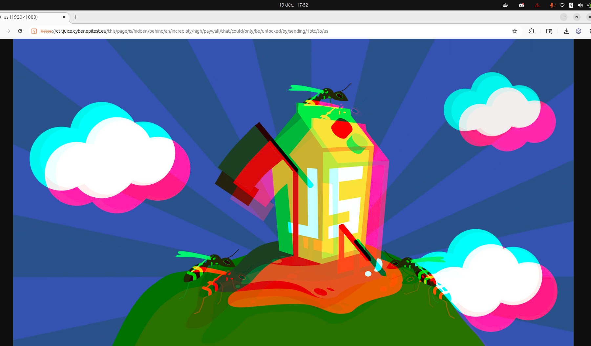

# **Cryptographic Issues-6-Premium Paywall**

## 1. Methodology

**Step 1 – Recherche de la clé de chiffrement**

- Utiliser un outil comme goBuster pour découvrir le répertoire /encryptionkeys.

**Step 2 – Téléchargement de la clé**

- Télécharger le fichier premium.key contenant la clé AES-128.

**Step 3 – Recherche des données cryptées**

- Analyser le code source pour trouver le commentaire cryptés.

**Step 4 – Décryptage**

- Utiliser OpenSSL pour décrypter la chaîne base64 avec la clé.

**Step 5 – Accès à l'URL cachée**

- Naviguer vers l'URL décryptée pour contourner le paywall.(this/page/is/hidden/behind/an/incredibly/high/paywall/that/could/only/be/unlocked/by/sending/1btc/to/us)

**Step 6 – Validation**

- Le challenge est validé en accédant à la page cachée.

## Techniques utilisées:

- Cryptographic Issues
- Sensitive Data Exposure

## Outils utilisés :

- goBuster
- OpenSSL

---

## 2. Vulnerabilities

**Vulnerability:**

- Cryptographic Issues
- Sensitive Data Exposure

**Affected component:**

- Répertoire /encryptionkeys et commentaires cryptés

**Severity:**

- **High**

---

## 3. Risks

- Exposition de clés de chiffrement et d'URLs cachées derrière des paywalls.

---

## 4. Actions

**Risk Mitigation**

- Sécuriser les répertoires sensibles et éviter de stocker des clés en clair.

**Remediation Fix**

- Utiliser des clés gérées et chiffrer les données sensibles correctement.

**Best Practices**

- OWASP Cryptographic Failures.

---

**Evidences**

