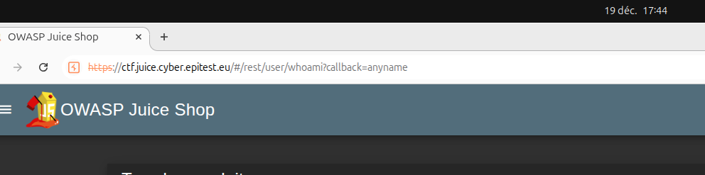

# **Sensitive Data Exposure-6-Email Leak**

## 1. Methodology

**Step 1 – Préparation**

- Utiliser Burp Suite et FoxyProxy pour intercepter les requêtes.

**Step 2 – Accès à l'API**

- Naviguer vers l'endpoint /rest/user/whoami avec un paramètre callback.

**Step 3 – Exploitation du callback**

- Utiliser un callback comme anyname pour récupérer les informations utilisateur.

**Step 4 – Observation des données**

- L'API retourne les informations des utilisateurs connectés, incluant l'email.

**Step 5 – Validation**

- Le challenge est validé en accédant aux données sensibles cross-domain.

## Techniques utilisées:

- Sensitive Data Exposure
- API Callback Exploitation

## Outils utilisés :

- Burp Suite
- FoxyProxy

---

## 2. Vulnerabilities

**Vulnerability:**

- Sensitive Data Exposure

**Affected component:**

- Endpoint /rest/user/whoami

**Severity:**

- **High**

---

## 3. Risks

- Exposition des emails et informations des utilisateurs connectés via des appels API non sécurisés.

---

## 4. Actions

**Risk Mitigation**

- Implémenter des contrôles d'accès stricts sur les endpoints API.

**Remediation Fix**

- Désactiver les callbacks non autorisés et ajouter une authentification.

**Best Practices**

- OWASP Sensitive Data Exposure.

---

**Evidences**

