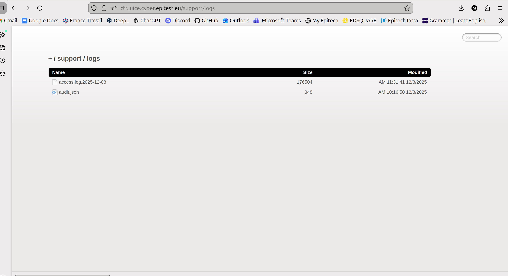
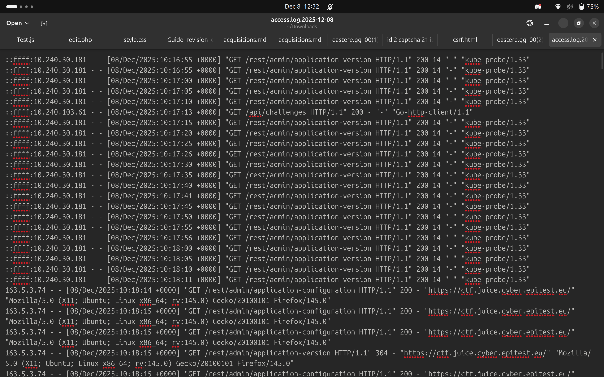

**_Sensitive Data Exposure – Level 4 – Access Log_**

## 1. Methodology

**Step 1 – Reconnaissance**

- Initial analysis of the target site to understand its general behavior.
- Observation of pages accessible without authentication.

**Step 2 – Navigation to /support/logs**

Access the page:

https://target-website.com/support/logs

No access control detected -> suspicion of **Broken Access Control**.

**Step 3 – Downloading the Log File**

- Direct download of the file (`access.log`).
- No authentication required -> exposure of a sensitive file.

**Step 4 – File Analysis**

The file potentially contains:

- IP addresses
- Internal paths
- Error messages
- Sensitive data

**Step 5 – Challenge Validation**

The challenge is validated once the log file is downloaded.

---

## Techniques Used

- Forced Browsing
- Direct Object Access
- Information Disclosure
- Broken Access Control Testing

---

## 2. Vulnerabilities

**Vulnerability:**

- Sensitive Data Exposure
- Broken Access Control
- Missing Authorization

**Affected Component:**

- `/support/logs` route and logging system

**Severity:**

- **High**

---

## 3. Risks

- Leakage of sensitive data through logs.
- Facilitation of advanced or targeted attacks.
- **Business impact:** data leak, loss of customer trust, reputational damage.

---

## 4. Actions

**Risk Mitigation**

- Restrict access to `/support/logs`.
- Move logs outside the public directory.
- Apply **Role-Based Access Control (RBAC)**.

**Remediation Fix**

- Add an authorization middleware.
- Block direct access to internal files.
- Review and harden server configuration.

**Example:** Authorization middleware

```js
if (!user || user.role !== "admin") {
  return res.status(403).json({ error: "Access denied" });
}
```

**Best Practices**

- Never expose logs publicly.
- Use a **Web Application Firewall (WAF)**.
- Follow OWASP security recommendations.
- Regularly audit permissions and access rules.

---

## 5. Evidence

**/support/logs Page**  


**Log File**  

