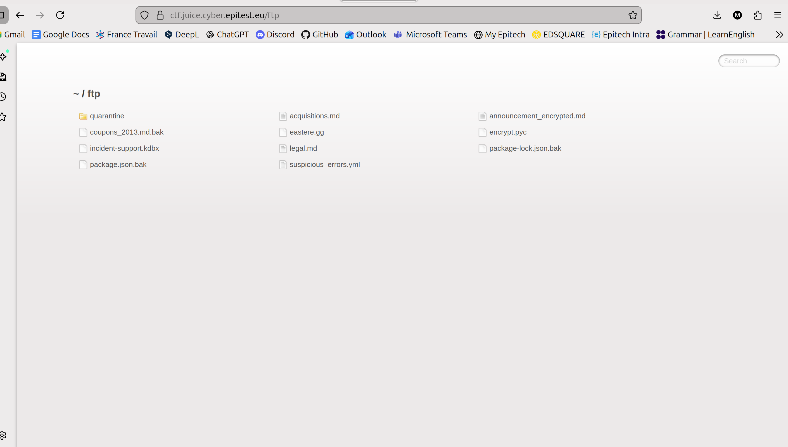
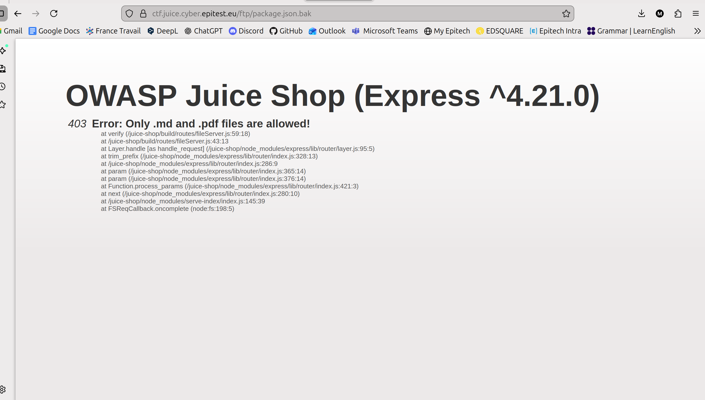
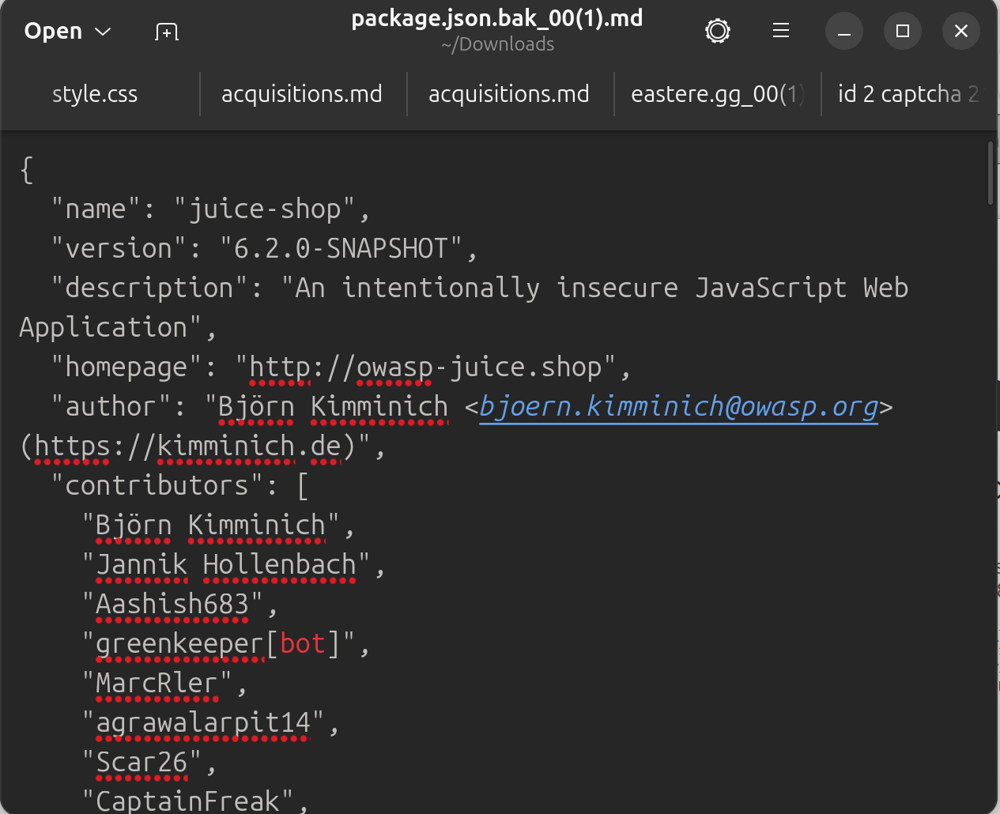

**_Sensitive Data Exposure – Level 4 – Forgotten Developer Backup_**

## 1. Methodology

**Step 1 – Reconnaissance**

- Navigation through the **OWASP Juice Shop** application.
- Observation of the URL structure.
- Search for forgotten backup files.

**Step 2 – Accessing the FTP Directory**

- Append `/ftp` to the URL:

  `https://juice-shop.example.com/ftp`

- The server exposes a list of files.

**Step 3 – Discovery of the Backup File**

- A file named:

  **package.json.bak**

- Attempting to open it directly fails.
- Message displayed: only `.md` or `.pdf` files are allowed.

**Step 4 – Bypassing the Extension Filter**

- Add a double-encoded Null Byte:

  **%2500.md**

- Full URL used:

  `https://juice-shop.example.com/ftp/package.json.bak%2500.md`

- The file downloads successfully.

**Step 5 – Analysis**

- Reading the backup file reveals internal dependencies and components.
- The challenge is validated.

---

## Techniques Used

- Information Disclosure
- Poison Null Byte Injection
- File Extension Filter Bypass
- Security Misconfiguration Exploitation

## Tools Used

- Web Browser
- URL Encoding (%2500)
- Basic OSINT

---

## 2. Vulnerabilities

**Vulnerability:**

- Sensitive Data Exposure
- Vulnerable & Outdated Components
- Forgotten Backup Exposure

**Affected Component:**

- FTP directory and backup files

**Severity:**

- **High**

---

## 3. Risks

- Leakage of internal information.
- Assists in reconnaissance and targeted attacks.
- Expands the attack surface.
- **Business Impact:** exposure of internal data that can facilitate targeted attacks + loss of user trust.

---

## 4. Actions

**Risk Mitigation**

- Remove all backup files.
- Restrict access to the FTP directory.

**Remediation Fix**

- Implement strict file extension validation.
- Normalize file paths.
- Store backups outside the web root.

**Example:** Blocking filenames containing Null Bytes (`\0`)

```js
if (filename.includes("\0") || filename.includes("%00")) {
  return res.status(400).json({ error: "Invalid filename" });
}
```

**Best Practices**

- Never deploy backups in production environments.
- Conduct regular security audits.
- Follow OWASP security recommendations.

---

## 5. Evidence

**OWASP Recommendation Site**  
https://cheatsheetseries.owasp.org/index.html

**FTP Directory**  


**Package.json.back File**  


**Downloaded Backup File**  

