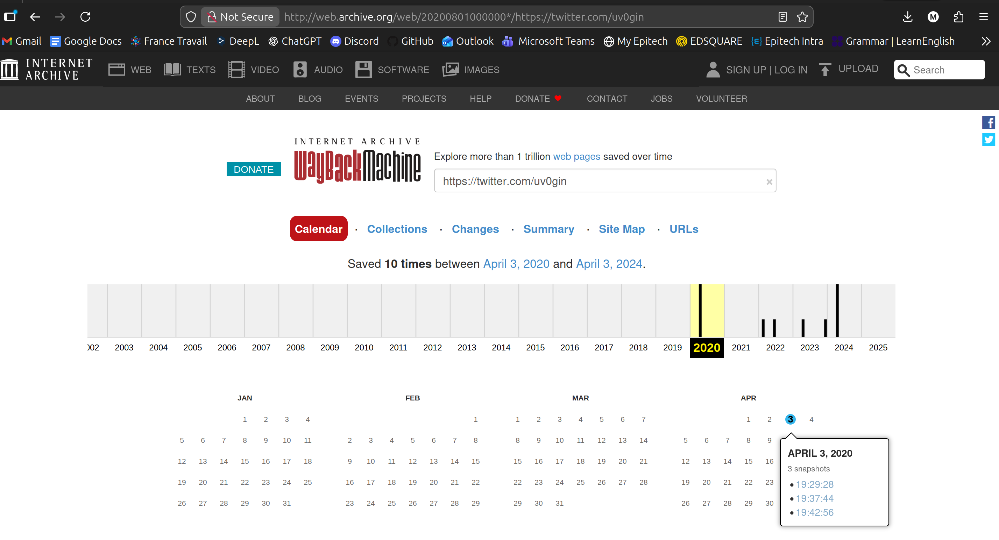
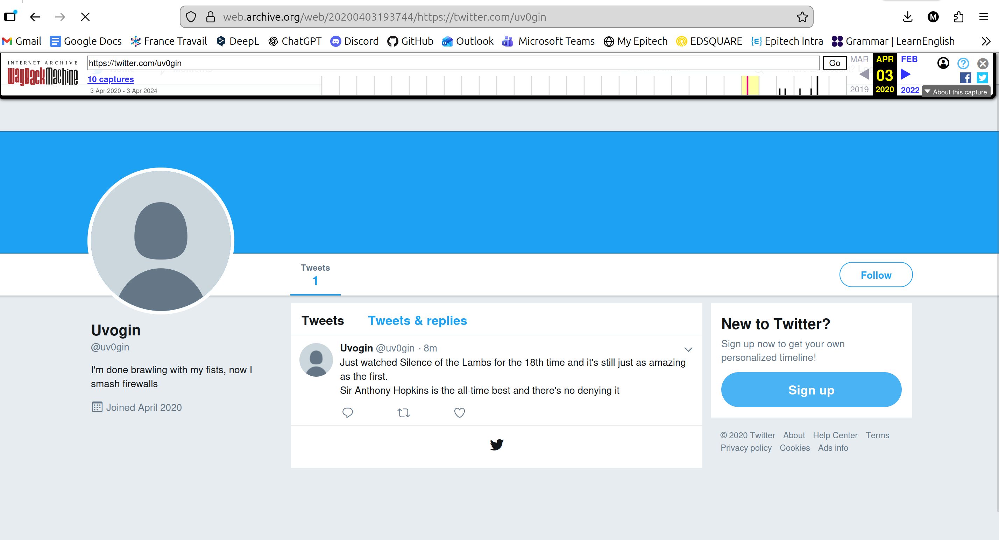

**_Sensitive Data Exposure – Level 4 – Reset Uvogin's Password_**

## 1. Methodology

**Step 1 – Reconnaissance**

- Navigation through the site to identify sensitive functionalities.
- Detection of the **“Forgot my password”** page.
- Analysis of the form: requires an **email** and a **personal question**.

**Step 2 – Identifying the Target**

- The target user is **Uvogin**.
- Entered his email on the password reset page.

**Step 3 – OSINT: Internet Research**

- Searched for the name **“Uvogin”**.
- Found a profile on **X (formerly Twitter)**:  
  https://x.com/uv0gin

**Step 4 – Exploration via Wayback Machine**

- Checked snapshots from 2025 -> none found.
- Checked 2024 -> two snapshots, not useful.
- Switched to the old Twitter URL:  
  https://twitter.com/uv0gin
- Searched from 2024–2022 -> no relevant results.
- A snapshot from **April 3, 2020 (7:37 PM)** mentioned the movie  
  **“Silence of the Lambs”**.

**Step 5 – Exploitation**

- Returned to the _Forgot my password_ page.
- Entered the secret question answer: **Silence of the Lambs**.
- Set a new password.
- Password reset successful -> account access obtained.

---

## Techniques Used

- OSINT (Open Source Intelligence)
- Account Takeover via Weak Password Recovery
- Information Disclosure via Archived Public Data

## Tools Used

- Web Browser
- Wayback Machine
- OSINT / Google Search Tools

---

## 2. Vulnerabilities

**Vulnerability:**

- Sensitive Data Exposure (via OSINT)
- Broken Authentication (weak password reset)
- Weak Security Question
- OSINT-Based Account Takeover

**Affected Component:**

- Password Reset Mechanism

**Severity:**

- **Critical** = Allows complete account takeover without authentication.

---

## 3. Risks

- Unauthorized account takeover.
- Access to sensitive or personal data.
- **Business impact:** data breach, loss of trust, reputational damage.

---

## 4. Actions

**Risk Mitigation**

- Remove security questions based on public or guessable data.
- Use **Multi-Factor Authentication (MFA)** or secure one-time reset links.
- Verify user identity through email or phone validation.

**Remediation Fix**

- Replace secret question systems with secure tokenized resets.
- Encrypt and protect recovery data.
- Add suspicious reset attempt detection.

**Example:** Token validation on the server side

```js
if (!isValidResetToken(token)) {
  return res.status(403).json({ error: "Invalid or expired token" });
}
```

**Best Practices**

- Avoid static or publicly known secret questions.
- Follow **OWASP Authentication** recommendations.
- Regularly audit account recovery mechanisms.

---

## 5. Evidence

**OWASP Authentication Guide**  
https://cheatsheetseries.owasp.org/cheatsheets/Authentication_Cheat_Sheet.html

**Wayback Machine Snapshot**  


**Uvogin Twitter Profile**  

