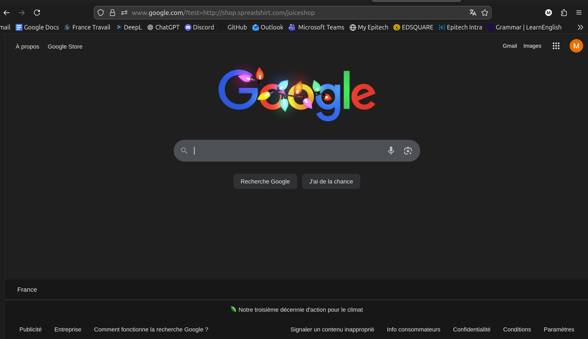

**_Unvalidated Redirects – Level 4 – Allowlist Bypass_**

## 1. Methodology

**Step 1 – Reconnaissance**

- Analyzed the **main.js** file using DevTools.
- Searched for the keyword **"redirect"**.
- Discovered an allowlisted domain:

      shop.spreadshirt.com

**Step 2 – Testing the Allowed URL**

- Constructed the URL:

      https://juice-shop.example.com/shop.spreadshirt.com

- Opened it in a new tab -> displayed a Spreadshirt page with T-shirts.

**Step 3 – Analyzing the Redirection Mechanism**

- The application uses the following redirection parameter:

      redirect?to=http://...

**Step 4 – Allowlist Bypass**

- Payload used:

      ?to=http://google.com/?test=shop.spreadshirt.com/juiceshop

- Final URL:

      https://ctf.juice.cyber.epitest.eu/redirect?to=http://google.com/?test=http://shop.spreadshirt.com/juiceshop

- Result: redirection to **Google** -> successful bypass.

- Challenge validated.

---

## Techniques Used

- Unvalidated Redirect Exploitation
- Allowlist Bypass via Substring Injection
- Business Logic Abuse

## Tools Used

- Browser DevTools

---

## 2. Vulnerabilities

**Vulnerability:**

- Unvalidated Redirects
- Improper Allowlist Validation

**Affected Component:**

- Redirect Handler

**Severity:**

- **High**

---

## 3. Risks

- Redirection to malicious websites.
- Phishing attacks facilitated.
- Loss of user trust.
- **Business Impact:** believable phishing campaigns could lead to financial loss and brand reputation damage.

---

## 4. Actions

**Risk Mitigation**

- Strictly validate the destination domain.
- Prevent substring matches from being treated as valid.
- Enforce server-side validation.

**Remediation Fix**

- Perform exact domain matching (full equality check).
- Canonicalize URLs before validation (convert multiple possible forms of a value into one “canonical” format for accurate comparison and filtering).
- Block all external redirections.

**Best Practices**

- Follow the **OWASP Unvalidated Redirects and Forwards Prevention Cheat Sheet**.
- Log all suspicious redirect attempts.

---

## 5. Evidence

**OWASP Redirect Prevention Cheat Sheet**  
https://cheatsheetseries.owasp.org/cheatsheets/Unvalidated_Redirects_and_Forwards_Cheat_Sheet.html

**Google Redirect Page**  

