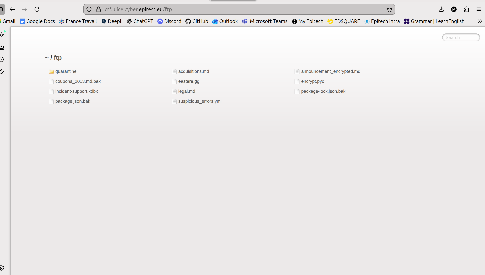
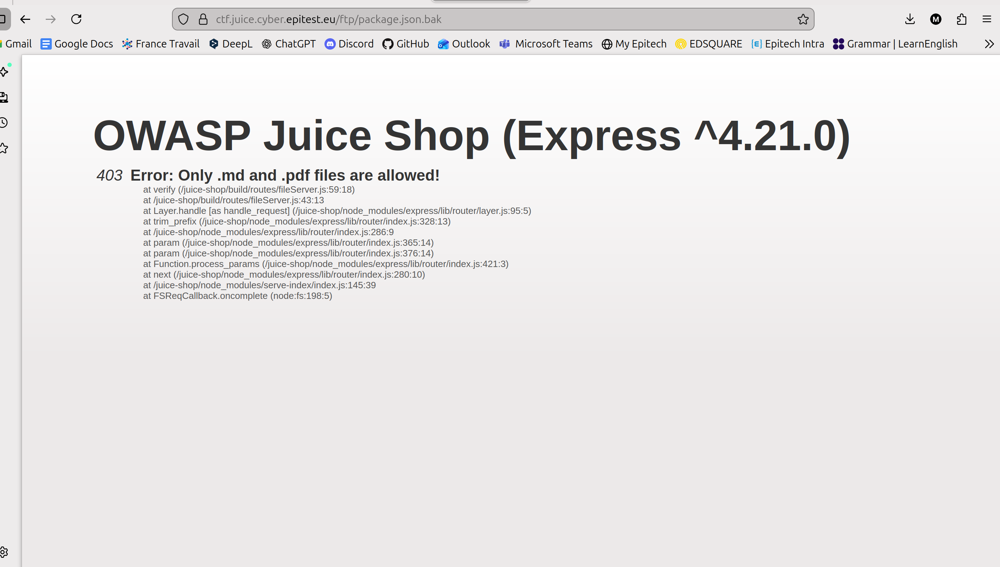
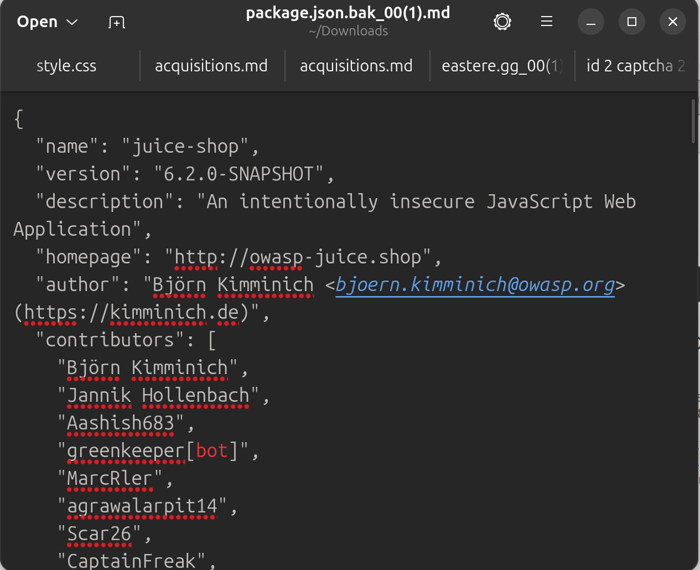
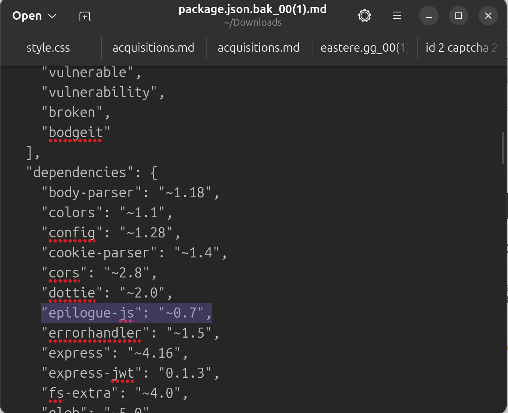
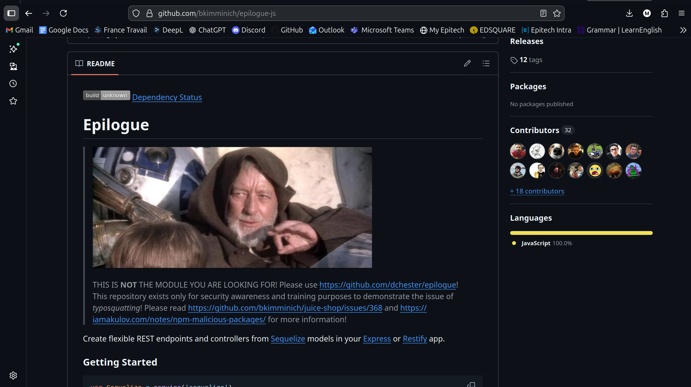

**_Vulnerable Components – Level 4 – Legacy Typosquatting_**

## 1. Methodology

**Step 1 – Reconnaissance**

- Browsed the **OWASP Juice Shop** website.
- Observed accessible URL paths.
- Attempted to access potentially exposed directories.

**Step 2 – Access to the FTP Directory**

- Modified the URL to access the FTP directory:

        https://juice-shop.example.com/ftp

- A list of publicly accessible files was displayed.

**Step 3 – Discovery of a Sensitive File**

- Found the file:

        package.json.bak

- Attempted direct access -> denied.
- Error message indicated that only `.md` or `.pdf` files were allowed.

**Step 4 – Bypassing the Extension Filter**

- Added a double-encoded Null Byte followed by an allowed extension:

        %2500.md

- Final URL used:

        https://juice-shop.example.com/ftp/package.json.bak%2500.md

- The file successfully downloaded.

**Step 5 – File Analysis**

- Opened the `package.json.bak` file.
- In the **dependencies** section, discovered the package:

        epilogue-js

**Step 6 – OSINT Research**

- Searched for **epilogue-js** on Google.
- Found the **kimminich** GitHub repository.
- Read the README of the **Epilogue** project.

**Step 7 – Exploitation**

- Navigated to the **Customer Feedback** page.
- Entered **Epilogue** in the _comments_ field.
- Added a rating and solved the CAPTCHA.
- Submitted the form.
- Challenge validated.

---

## Techniques Used

- Forced Browsing
- Null Byte Injection
- OSINT (Dependency Intelligence)

## Tools Used

- Web Browser
- URL Encoding (%2500)
- Google / OSINT Research

---

## 2. Vulnerabilities

**Vulnerability:**

- Vulnerable & Outdated Components
- Legacy File Exposure

**Affected Component:**

- Dependencies and exposed FTP directory

**Severity:**

- **High** = Internal dependency disclosure enables targeted and supply chain attacks.

---

## 3. Risks

- Exposure of internal dependencies.
- Identification of vulnerable components.
- Facilitation of targeted or supply chain attacks.
- **Business Impact:** data leakage and reputational damage.

---

## 4. Actions

**Risk Mitigation**

- Restrict access to the `/ftp` directory.
- Remove backup files (`.bak`).
- Block control characters (`%00`, `%2500`).

**Remediation Fix**

- Implement strict server-side file extension validation.
- Normalize file paths before processing.
- Store sensitive files outside the web root.

**Best Practices**

- Regularly audit dependencies.
- Update or remove obsolete components.
- Follow OWASP’s **Vulnerable Dependency Management** recommendations.

---

## 5. Evidence

**OWASP Vulnerable Dependency Management Cheat Sheet**  
https://cheatsheetseries.owasp.org/cheatsheets/Vulnerable_Dependency_Management_Cheat_Sheet.html

**FTP Directory**  

**Package.json.bak**  

**Downloaded Backup File**  

**Epilogue-js**  

**Epilogue README by Kimminich**  

