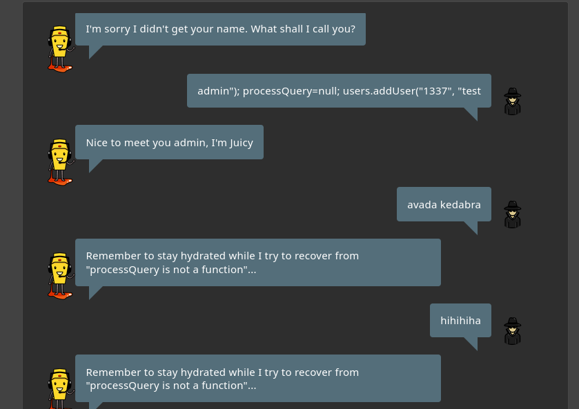

# **Vulnerable Components - 5-Kill Chatbot**

## 1. Methodology

**Step 1 – Preparation**

- Access the chatbot in the Juice Shop app.

**Step 2 – Malicious Code Injection**

- Send the injection string: admin"); processQuery=null; users.addUser("1337", "test"

**Step 3 – Error Observation**

- The chatbot returns an error after the injection.

**Step 4 – Continued Interaction**

- Continue interacting with the chatbot to trigger validation.

**Step 5 – Validation**

- The "Kill Chatbot" challenge is validated due to the persistent error.

## Techniques Used:

- Injection
- Code Execution

## Tools Used:

- Web Browser

---

## 2. Vulnerabilities

**Vulnerability:**

- Injection
- Improper Input Validation

**Affected Component:**

- Application Chatbot

**Severity:**

- **High**

---

## 3. Risks

- Arbitrary code execution via the chatbot, allowing unauthorized actions such as adding users.

- Business impact: loss of user trust, lack of user support, customer loss due to loss of support.

---

## 4. Actions

**Risk Mitigation**

- Implement strict validation of user input in the chatbot.

**Remediation Fix**

- Escape special characters and use parameterized queries.

**Best Practices**

- OWASP Injection Prevention.

---

## 5. Evidence

**Injection into the chatbot**

