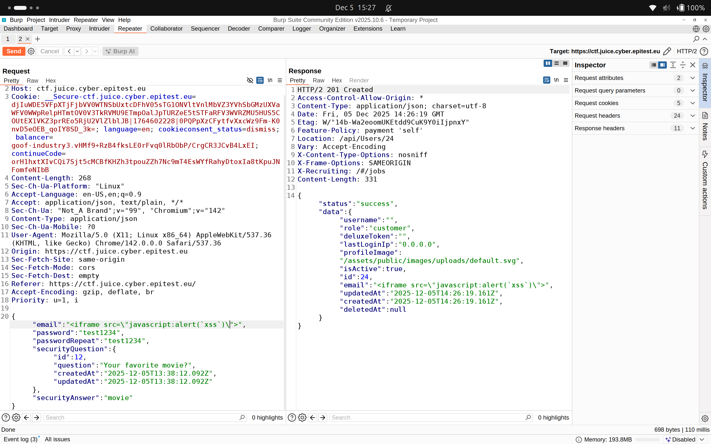

**_XSS – Level 3 – Client-side XSS Protection Bypass_**

## 1. Methodology

**Step 1 – Go to the Registration Page**

- Go to the **Login** page.
- Click **“Not yet a customer”**.
- Create a new account.

**Step 2 – Prepare Burp Suite**

- Open **Burp Suite -> Proxy**.
- Turn **Intercept ON**.
- Go back to the site and click **Register** to send the request.

**Step 3 – Send the Request to Repeater**

- In **Burp -> Proxy**, find the **POST registration request**.
- Right-click -> **Send to Repeater**.

**Step 4 – Modify the Email Field to Inject XSS**

- In **Repeater**, locate the `"email"` field.
- Replace it with the payload:  
  `<iframe src=\"javascript:alert('xss')\">`
- Important: Backslashes must be escaped to avoid JSON syntax errors.

**Step 5 – Send the Request**

- Click **Send**.
- Observe the response.

**Step 6 – Validation**

- The server response contains:  
  `"status": "success"`  
  -> The XSS payload is accepted, meaning client-side protection has been bypassed.
- Challenge validated

---

## Techniques Used

- Client-side XSS Protection Bypass
- Stored XSS Injection
- Parameter Tampering

## Tools Used

- **Burp Suite** (Proxy + Repeater)

---

## 2. Vulnerabilities

**Vulnerability name:**

- Persistent XSS (Stored XSS)

**Affected Component:**

- User registration API endpoint
- JSON field `"email"`

**Severity:**

- **High**

---

## 3. Risks

- Execution of malicious JavaScript in users’ browsers.
- Theft of cookies and JWT tokens.
- Persistent injection in the user database.
- Data leakage and site compromise.
- **Business impact:** loss of user trust + legal/compliance risks (GDPR).

---

## 4. Actions

**Mitigation**

- Never rely on client-side validation.
- Sanitize all inputs on the server side.
- Remove or escape dangerous HTML tags.

**Remediation**

- Automatically encode `<`, `>`, `"`, `'`.
- Use a robust sanitization engine.
- Validate that the email field contains a proper email format.

**Example:** strict validation of the email field

```js
import validator from "validator";

if (!validator.isEmail(email)) {
  return res.status(400).json({ error: "Invalid email format" });
}
```

**Best Practices**

- Implement a **Content Security Policy (CSP)**.
- Regularly audit all input forms.
- Automate testing against XSS vulnerabilities.

---

## 5. Evidence

Injected Payload:  
`<iframe src=\"javascript:alert('xss')\">`

Server Response:  
`"status": "success"`

**Result of the Request with Injected Payload**  

